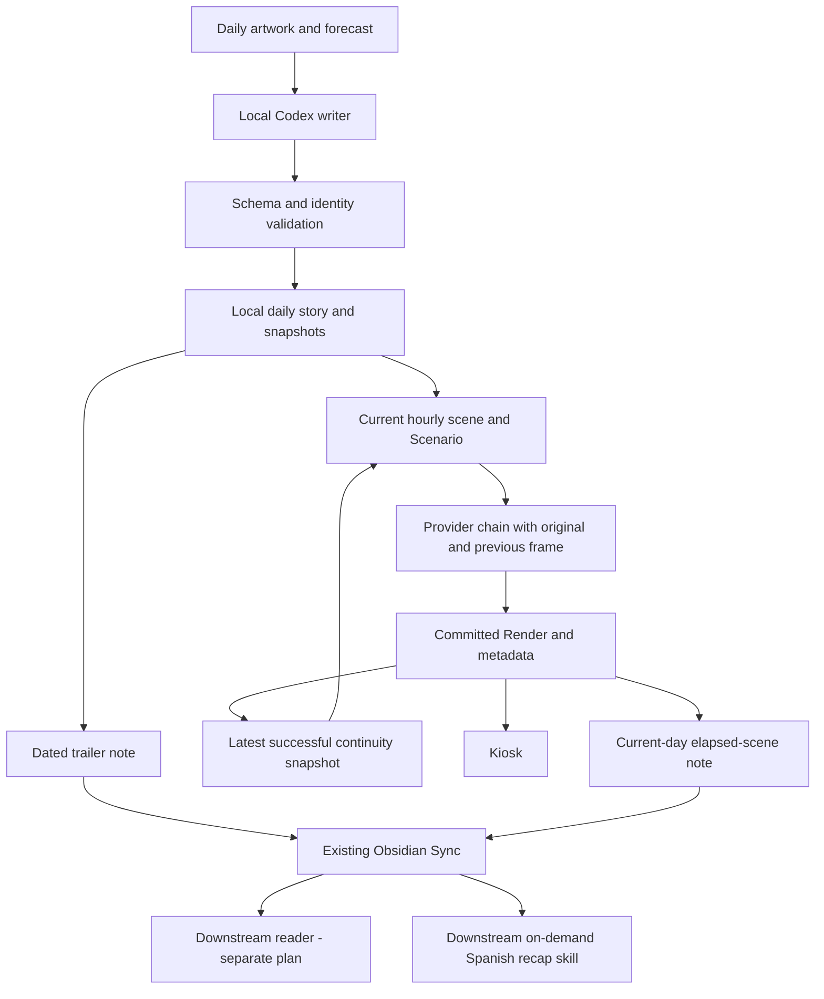
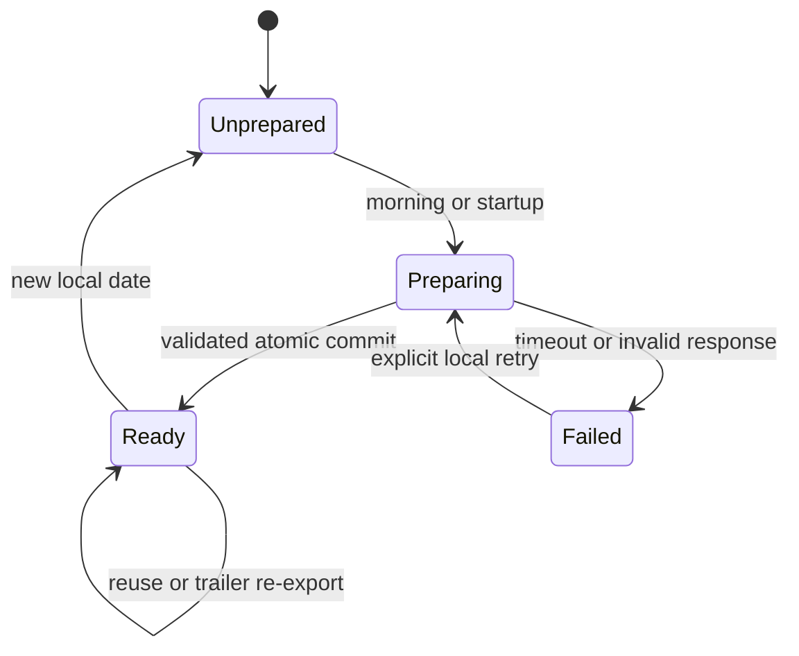
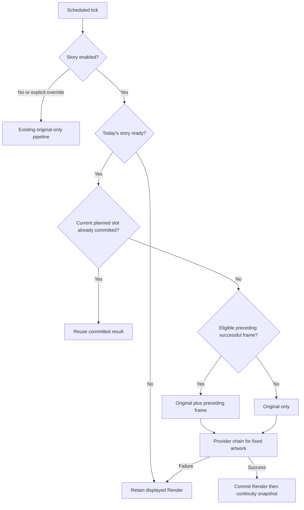

# Daily artwork stories - Plan

## Goal Capsule

**Objective:** The household can follow a distinctive, uplifting story unfolding in the TV artwork each day, even when they miss hourly images.

**Means:** A local Codex writer prepares the story and trailer; scheduled images use the selected D reference strategy.

**Product authority:** The separately maintained coordination plan records the approved shared scope; private repository identifiers are omitted. This plan implements its Haystack portion only.

**Launch blockers:** None for local Haystack implementation. Live model availability and Obsidian note arrival are implementation checks. Downstream assistant deployment is outside this plan. Its message integration needs active-source verification; the independent recap skill needs consumer-workspace comparison and existing Obsidian-skill verification.

## Product Contract

### Summary

Add daily story preparation, coherent scheduled images, a dated trailer export and a current-day elapsed-scene recap export. Preserve independent interactive editing and existing TV delivery.

### Problem Frame

The current hourly prompt repeatedly invents similar generic situations. The approved eight-frame comparison favored original-plus-previous-frame continuity, but production still uses one source image. A daily written story gives each scheduled image a specific situation and progression.

### Requirements

**Daily narrative**

- R1. Each local day has one complete standalone story with an identifiable cast, progression and ending.
- R2. The local writer uses GPT 6.1 Sol at medium effort through Codex's ChatGPT login, receiving the selected artwork, daily forecast and brief recent-story summaries.
- R3. Stories should be optimistic, funny or inspiring, with specific visible situations and enough variety to avoid interchangeable daily plots.
- R4. The first version uses one writer call with a short goal-oriented prompt; random seeds remain an optional experiment.
- R5. Hourly scenes communicate through visible poses, props and relationships and remain intelligible when earlier scenes were missed.

**Rendering and introduction**

- R6. The first daily image starts from the original artwork; later story images use that original and the previous successful image from the same story day.
- R7. The published daily premise stays consistent with its trailer while current weather may change staging and lighting.
- R9. A dated, ready trailer and a separate current-day recap of committed story scenes are made available through existing Obsidian sync. Future scenes and the full planned ending remain with Haystack.
- R10. Preparation and synchronization finish before the message needs them; missing or stale trailers cause the message section to be omitted.
- R12. Prepare and review repository-local changes independently; live schedule changes, deployment and test messages require a separate execution step.
- R13. TV features use only their exact shared note paths; they do not introduce general private-note reading or whole-vault searches.
- R14. Story mode does not change independent interactive, scenario-override or extend-artwork behavior.

**On-demand recap producer**

- R16. Export one current-day Markdown recap grouped by story hour, replaced each day, without an exported historical-story archive. Existing local narrative history is unaffected.
- R17. Export only successfully committed same-story render progress; elapsed time, skipped/failed slots and future fields cannot advance the recap.
- R18. Export exact dated/identified readiness and progress fields so the downstream assistant can validate them. A ready story before its first render exposes only its spoiler-free trailer.

### Key Decisions

- **D is selected after visual review.** Governs R6. (session-settled: user-directed — chosen over A, B and C: D looked best, C degraded, and A/B were indistinguishable.)
- **Standalone daily stories.** Governs R1. (session-settled: user-directed — chosen over recurring or multi-day stories: no prior-day context is needed.)
- **Start with a single local writer.** Governs R2 and R4. (session-settled: user-approved — chosen over mandatory critics and tournaments: judge real samples before adding machinery.)
- **Keep future plot local; export completed scenes for questions.** Governs R9, R13 and R16–R18. (session-settled: user-directed — the on-demand recap extension supersedes the earlier trailer-only handoff. The existing message still uses only the trailer.)

### Actors and Flows

A1 is the household; A2 is Haystack; A3 is the local Codex writer; A4 is the downstream assistant consuming the trailer.

- F1. Before the message, A2 selects today's artwork and forecast, asks A3 for a story, commits validated story state and exports the trailer under R9.
- F2. Each active hour A2 selects the current scene, builds current Scenario conditions and uses R6's references.
- F3. A4 consumes the shared trailer under the separate consumer plan; Haystack supplies only the producer side.
- F4. A2 publishes a current-day elapsed-scene note for the separately owned downstream consumer skill that answers household Spanish TV-story questions.

### Acceptance Examples

- AE1. Seeing only the first, fourth and last frames still reveals the cast and a meaningful progression. Covers R1, R5 and R6.
- AE2. Instructions for early scenes do not introduce a character whose first entrance is at midday. Covers R1 and R5.
- AE3. The trailer introduces the situation and tone without giving away the ending. Covers R9.
- AE4. A missing or yesterday-dated trailer is ineligible for today's message. Covers R9 and R10; consumer proof belongs to the downstream assistant.
- AE5. Changed weather does not replace the announced premise or cast. Covers R7.

- AE6. At 14:30 with a failed 14:00 render, the note ends at the last successful 13:00 scene rather than the scheduled 14:00 action. Covers R17.
- AE7. Before the first render, only the spoiler-free trailer is exported in the recap. Covers R18.
- AE8. Rollover and delayed completions cannot overwrite today's recap with yesterday's story; no recap archive is created. Covers R16–R18.
- AE9. Future scene and ending markers in local story fixtures are absent from all exported recap fields. Covers R9 and R17.

### Success Criteria

Use human judgment on story specificity, warmth, visual readability and progression. The porter/pelican sequence is a taste reference, not a daily plot template. Tests establish structural correctness rather than a numerical humor score. D's eight-frame result is evidence for selection, not proof of full-day or multi-provider stability.

<!-- ce-section: work-relationships -->
### Ownership and Scope Boundaries

This plan covers Haystack's producer and renderer only, including the recap exporter. Coordination R15 and the consumer portion of R18 belong to a separately maintained downstream `tv-story-so-far` skill; no consumer skill files are created here. Coordination R8 and R11 cover adding `¿Qué pasa hoy en la tele?` to an existing message; their implementation belongs to the downstream assistant and is deferred until its active source is verified.

No recurring cast, multi-day serial, mandatory critic, candidate tournament, image-based plot replanning, aesthetic retries, extra messages, new sync service, whole-vault reading or general agent platform is included. Do not broaden active-hour rules, refactor provider deadlines, or redesign the Lab UI.

## Planning Contract

**Product Contract preservation:** Regenerated scoped projection of the approved coordination plan: R1–R7, R9–R10, R12–R13 and producer portions of R16–R18; R8/R11/R15 and consumer behavior remain owned by the downstream assistant. R14 preserves existing non-story paths. U1–U6 are implemented in PR #3; U7 below is the new planned extension, not a claim of implemented recap support.

### Key Technical Decisions

- KTD1. **Explicit story mode for scheduled ticks.** Add opt-in `HAYSTACK_STORY_ENABLED`, initially false for rollout, and keep overrides on the existing original-only path. A ready story binds the selected date, artwork hash and story ID. A missing story holds the existing display rather than inventing a paid replacement. Governs R6, R7 and R14.
- KTD2. **Versioned local story state outside output purge.** Persist one strict JSON story per configured local date, an immutable original snapshot and the latest successful continuity image under the story state directory. Commit JSON atomically before exporting the public note. Sidecars are the render commit authority; repair a lagging continuity pointer from validated same-story committed outputs on restart. Governs R1, R6 and R9.
- KTD3. **One bounded CLI request, with engine-owned persistence.** Use `spawn` with argv and no shell, a validated absolute Codex executable, dedicated staging cwd, image attachment, JSON output schema, `gpt-6.1-sol`, medium effort, ephemeral/read-only execution, `--ignore-user-config`, and the existing ChatGPT authentication. Do not inherit app/MCP connectors or hooks. Supply a minimal child environment for runtime, locale and the supported auth context, excluding image-provider keys and unrelated credentials; image-provider configuration remains unchanged. Bound execution to 300 seconds and captured output to 1 MiB; do not add automatic writer retries. A ready daily story is reused, not regenerated. Governs R2 and R4.
- KTD4. **Frozen identity with complete visible scene states.** Request exactly the configured active-hour slots. Store cast identity separately from per-scene presence; compose only the characters present in the current slot, with their relevant identity descriptions. Each scene states cumulative prop/location state and current action, so skipping hours does not require replay. Fresh Scenario weather controls physical conditions; it must not replace the story premise. Governs R1, R5 and R7.
- KTD5. **Original remains canonical across the provider chain.** Extend provider input with ordered optional reference images rather than substituting the previous frame for `source`. Snapshot and validate all bytes once; pass independent copies in the same order to OpenAI, Gemini and xAI. Derive geometry from the original, retain existing deadlines and retry behavior, and record actual reference hashes. Bootstrap the first successful daily Render from the original, including after a late wake. Once an eligible prior Render exists, never silently drop its reference; an unavailable or corrupt required snapshot holds the display until recovered. Governs R6 and R14.
- KTD6. **Successful same-story references and story-aware dedup.** A previous frame must match story ID, date and artwork hash and precede the requested scene hour. A failed attempt never becomes a reference. Both scheduler precheck and mutex-owned check match the story/slot rather than generic latest output. Disable alternate-artwork fallback for ready story mode while keeping the existing provider chain. Governs R6 and R7.
- KTD7. **Exact shared trailer note.** Follow the approved Shared Handoff Contract: one atomic `Haystack/TV Today.md` note, allowed header fields and the approved body. Configure its destination separately from local story state. Do not supply vault paths, private-note contents, trailer destinations or downstream assistant connectors to the writer. Read-only mode is a write restriction, not a claim of filesystem read isolation. Publishing failure is logged and an explicit export operation can retry without another writer call. Governs R9, R10 and R13.
- KTD8. **Morning preparation independent of image hours.** Configure a preparation time, default 06:45 Europe/Madrid, with startup catch-up before today's active-end boundary. Catch-up prepares only Unprepared state; a persisted Failed attempt requires the explicit local retry command. Reuse `getImageForToday` for today only; never mutate rotation by asking it to select tomorrow. Snapshot the source before writer invocation and use that committed snapshot throughout the day. Prepare with full-day `getForecast`; a missing/invalid forecast yields no ready story or trailer. Governs R2, R7 and R10.

- KTD9. **Publish only committed progress at the source.** Add the exact `Haystack/TV Story So Far.md` contract from the coordination revision alongside the unchanged trailer note. Publish trailer-only zero-progress after daily story commit; then replace the recap after each successful same-story Render commit. Build hour sections from validated commit evidence and the corresponding current scene state/action, never full premise, full cast, future scenes or separate ending. Reject future-hour/wrong-identity commits and previous-day late completions. Recovery/export retry reuses committed state, with no writer/image call. Use a single fixed note, atomic replacement and versioned date/story identity; no recap archive. Governs R9 and R16–R18.

### High-Level Technical Design

### Data and Prompt Boundaries

The story JSON schema contains schema version, date, timezone, artwork fingerprint, story ID, title, Spanish trailer, a short premise/history summary, stable character identities and an ordered list of active-hour scenes with presence and complete visible state. The engine supplies and verifies identity fields; model output cannot change selection or commit paths. Reject duplicate/missing/out-of-window hours, unknown character IDs, wrong date, wrong artwork or non-finite forecast data before committing. Use ISO strings, not Date objects, in stored metadata.

The writer prompt describes the audience and desired outcome, the supplied artwork/weather, standalone progression, visual legibility and one-sentence spoiler-free trailer. Give it recent public story summaries, initially the last 14 ready stories. Do not prescribe stock plot categories or repeat the porter/pelican example verbatim. The output schema handles structure; the creative instructions stay short. Honor the user's two OpenAI prompting guides as the prompt design source, adapting behavior only after viewing actual samples.

Hourly composition separates reference roles, the current visible scene and fresh Scenario. It includes enough cast detail to preserve identity without enumerating later entrances as if they were already present. Treat all story/trailer fields as data; they cannot invoke shell commands, alter provider settings or request downstream assistant messages.

### Assumptions and Deferred Checks

- The configured Mac can be awake before the downstream delivery deadline; launchd cannot overcome clamshell sleep. A late wake produces no retroactive message or additional message.
- CLI help and login status confirm image/schema support and ChatGPT login; the exact writer-model invocation under launchd must be proved during implementation, not assumed from those checks.
- Obsidian sync is documented, not currently measured. End-to-end arrival and current-date reading are release checks; no new transport is introduced.
- Gemini/xAI multi-image payloads are supported by current transport shapes, but D's visual quality on those providers remains unproven. Do not claim it matches the OpenAI prototype.
- No new confidence score or novelty metric is planned: real sample review remains the acceptance signal in Success Criteria.

### Alternatives Considered

Running the writer as a paid text API call inside Haystack would avoid CLI lifecycle concerns but does not use the user's chosen subscription path. Running it on the downstream assistant would require supplying the selected artwork/forecast to the VPS and widen that handoff. The selected local CLI keeps source selection and plot ownership together. A separate story service, mandatory critic and previous-image-driven replotting add no proven benefit to this first version.

## Implementation Units

### U1. Store and validate daily story state

**Goal:** Make a committed daily story and its required image bytes durable independently of normal output retention.

**Requirements:** R1, R6 and R9; KTD2 and KTD4. **Dependencies:** None.

**Files:** New `src/story/types.ts`, `src/story/schema.ts`, `src/story/story-store.ts`, `tests/story/story-store.test.ts` and `tests/story/schema.test.ts`.

**Approach:** Implement identity/slot validation and atomic commit/load. Store original/continuity snapshots with hashes. Add recovery from output-store commit records without accepting an unvalidated or wrong-story image.

**Patterns:** `src/storage/output-store.ts`, timezone helpers and JSON-safe metadata.

**Test scenarios:**

- An interrupted story write is not returned as ready.
- A wrong date/artwork or duplicate/missing slot is rejected.
- Purging normal outputs leaves story snapshots usable.
- Restart after Render commit but before continuity update repairs from a validated same-story result; otherwise uses the previously committed snapshot.

**Verification:** Temp-directory tests demonstrate atomic identity and reference ownership without provider calls.

### U2. Prepare a story with the local Codex writer

**Goal:** Turn today's selected artwork and full forecast into one reusable story proposal.

**Requirements:** R1–R5; F1; KTD3, KTD4 and KTD8. **Dependencies:** U1.

**Files:** New `src/story/codex-writer.ts`, `src/story/writer-prompt.ts`, `src/story/prepare-story.ts`, `tests/story/codex-writer.test.ts`, `tests/story/prepare-story.test.ts`.

**Approach:** Build bounded inputs from today's rotation selection and `getForecast`. Snapshot the original before invoking the child. Validate its structured result through U1. Use singleflight/exclusive preparation ownership; a ready artifact wins over a competing/stale attempt. Record sanitized failure and permit only explicit failed-attempt retry.

**Test scenarios:**

- A valid child response becomes one ready story; a duplicate preparation makes no second invocation.
- Timeout, nonzero exit, malformed JSON and model identity mismatch publish nothing.
- Child environment preserves ChatGPT auth context without image-provider keys or unrelated credentials; argv and runtime smoke checks confirm inherited connectors and hooks are unavailable.
- Missing forecast or active-hour holes leave preparation unavailable.

**Verification:** Fake subprocess/clock tests plus a bounded real subscription-backed writer sample during implementation; no image calls or vault writes in that sample.

### U3. Carry ordered references through all image providers

**Goal:** Support D while preserving canonical original geometry and existing fallback contracts.

**Requirements:** R6 and R14; KTD5. **Dependencies:** None.

**Files:** `src/engine/provider-types.ts`, `provider-chain.ts`, `openai-client.ts`, `gemini-client.ts`, `xai-client.ts`, `pipeline.ts`, `types.ts`; `tests/engine/provider-adapters.test.ts`, `provider-chain.test.ts` and `pipeline.test.ts`.

**Approach:** Add a backward-compatible optional ordered reference list and explicit story generation context. Validate reference bytes once, clone per provider, send original first and prior frame second. Add optional metadata identifying story/scene and reference provenance while keeping kiosk presentation allowlisted.

**Test scenarios:**

- All adapters receive two ordered images, derive geometry from the canonical original, and retain existing resolution and aspect-ratio validation rules: OpenAI uses its quantized near-2K size and Gemini/xAI retain their normal 1K profiles.
- A provider mutation does not alter reference bytes seen by the next fallback.
- Original-only calls and artwork extension retain their existing payloads.

**Verification:** Contract tests inspect payloads and metadata; do not silently reduce D to A on fallback.

### U4. Run scheduled scenes with continuity and recovery

**Goal:** Render the current story scene consistently across missed hours and restarts.

**Requirements:** R5–R7 and R14; F2; KTD1, KTD4 and KTD6. **Dependencies:** U1–U3.

**Files:** `src/server/scheduler.ts`, `src/server/start.ts`, `src/server/server.ts`, new `src/story/scene-prompt.ts`; `tests/server/scheduler.test.ts`, `server.test.ts`, `tests/story/scene-prompt.test.ts`.

**Approach:** Preserve the scheduler mutex and backup trigger behavior. Use the current planned slot and eligible preceding same-story reference; update dedup at both checks. Ready story mode fixes artwork across chain exhaustion; overrides retain current behavior.

**Test scenarios:**

- Covers AE1. Jumping from the first to fourth scene supplies its complete state and the first scene's image.
- Covers AE2. Only current-scene character IDs enter hourly instructions.
- A failed attempt does not commit a successful-reference pointer.
- A late first successful Render bootstraps from the original; later renders keep its eligible reference.
- A generic interactive Render cannot suppress a scheduled story scene in the same hour.
- Yesterday's, future-slot or wrong-artwork output is rejected as continuity input.
- Midnight resets reference ownership even when a previous attempt completes late.
- Provider-chain exhaustion keeps the visible Render and never switches the announced artwork.
- Covers AE5. Changed Scenario conditions retain story identity and scene intent.

**Verification:** Scheduler integration tests with fake clocks/weather and temp stores prove no backlog replay or duplicate story requests.

### U5. Export the trailer and schedule preparation

**Goal:** Make the approved trailer available early without giving the writer access to the vault.

**Requirements:** R9, R10, R12 and R13; KTD7 and KTD8. **Dependencies:** U2 and U4.

**Files:** New `src/story/trailer-export.ts`, `scripts/prepare-daily-story.ts`; `src/config/config.ts`, `src/server/start.ts`, `scripts/start-server.sh`, `.env.example`, `package.json`; `tests/story/trailer-export.test.ts`, `tests/config/config.test.ts`, `tests/server/launchd-config.test.ts`.

**Approach:** Add validated local configuration for story mode, preparation time, story-state directory, CLI path and trailer destination. Reuse the resident server for morning preparation and startup catch-up. Provide an explicit local prepare/export command for inspection and recovery; it does not invoke the downstream assistant. Follow the exact coordination note contract. Source paths are configuration, not private note contents.

**Test scenarios:**

- Trailer export occurs only after story commit and contains only allowed public fields.
- A failed export can be retried from the same ready story with no writer call.
- A Mac waking during the active window prepares once and renders the current scene; after active end it waits for next day.
- Restart after a persisted Failed preparation makes no writer invocation.
- Absolute CLI resolution works with the launchd wrapper's minimal PATH.
- Covers AE4. Fixture notes carry an exact quoted local date, and a stale note is never relabeled as today.

**Verification:** Temporary vault-directory fixtures and runtime smoke checks before any approved deployment; no live message edits or test messages.

### U6. Verify creative behavior and document activation

**Goal:** Make the implementation reviewable and its remaining visual limits explicit.

**Requirements:** R3, R5, R12 and R14; Success Criteria. **Dependencies:** U1–U5.

**Files:** `AGENTS.md`, `CONCEPTS.md`, `README.md`, new `docs/daily-stories.md`; existing scheduler/provider test fixtures as required.

**Approach:** Update the original-only instruction to describe the scheduled-story exception. Document CLI/model authentication, day reset, missing-story behavior, preparation timing, and consumer handoff. Inspect several writer outputs on contrasting artworks/forecast fixtures with the user; judge premise variety, visual feasibility and trailer spoilers. Do not equate structural validation with creative acceptance.

**Test expectation:** No prose-only tests. Behavioral checks belong to the units above.

**Verification:** Review captures actual sample outcomes and distinguishes the existing eight-frame proof from a future full-active-window trial. New paid image trials require their own scope and budget; deployment remains separate.

### U7. Export the current story so far

**Status:** Planned extension after implemented U1–U6; not deployed.

**Goal:** Give the downstream consumer skill a small current-day Markdown note containing context and committed progress without future spoilers.

**Requirements:** R9, R13 and R16–R18; F4; AE6–AE9; KTD9. **Dependencies:** U1, U4 and U5.

**Files:** New `src/story/recap-export.ts` and `tests/story/recap-export.test.ts`; `src/story/preparation-service.ts`, `src/story/story-store.ts`, `src/server/scheduler.ts`, `scripts/prepare-daily-story.ts`, relevant scheduler/service tests and `docs/daily-stories.md`.

**Approach:** Reuse the configured vault root, trailer atomic-write pattern and Render commit identity/ownership. Initialize an empty-progress note when today's story becomes ready. After a successful story Render, publish the eligible committed scene sections up to current Madrid time. Failed/skipped slots are not added; later scene cumulative state may explain the current situation without inventing skipped events. Keep the latest-scene hour and updated-at explicit. Replay eligible current-day commit evidence for recovery and provide explicit re-export without generation. Keep exporter errors from invalidating successful renders. Serialize snapshot/publication ownership so an older export cannot replace a newer prefix; recheck date at publication and reject late yesterday exports. No new telemetry, retention framework or private-note search.

**Test scenarios:**

- Before the first frame, the note contains only trailer/context and nullable progress.
- At 14:30 a failed 14:00 slot leaves 13:00 as latest; future/interactive/wrong-story renders are excluded.
- Skipped slots remain gaps; later committed current-state descriptions do not manufacture a missing sequence.
- Future cast/scene/ending fixture markers never enter note body or metadata.
- A committed ending enters the recap only when its final frame commits.
- Midnight and delayed earlier exports cannot replace today's note or a newer same-day prefix.
- Export failure/restart recovery republishes from committed evidence without another writer/image call; normal image purge does not erase required recap evidence (use durable story-owned progress, not only retained image files).
- Only the two fixed current-day public notes are written; no dated recap files or live-vault tests.

**Verification:** Temporary-vault and scheduler/service integration fixtures establish prefix ownership, recovery and no-spoiler fields. The consumer's Spanish invocation/no-spoiler behavior is verified in its separate owning plan. Commit progress is generated-scene evidence, not a kiosk display acknowledgement.

## Verification Contract

| Check | Evidence | Units |
|---|---|---|
| TypeScript build | `npm run build` succeeds | U1–U5 |
| Focused behavioral coverage | Vitest for story, provider adapters/chain/pipeline, scheduler/server, config and launchd contracts | U1–U5 |
| Regression suite | `npm run test:run` once after focused checks pass | U1–U5 |
| Writer CLI smoke | Recorded model/effort, schema-valid output and ChatGPT login under production-like environment, outside live vault | U2, U5 |
| Creative review | Household judgment of actual sample stories and spoiler-free trailers | U6 |
| Recap producer | Current-day zero-progress/committed-prefix, future-marker exclusion, publication ordering and date reset using temp fixtures | U7 |
| Downstream assistant end-to-end handoff | Deferred to separate owning plan; exact date/readiness and existing single-message contract | Outside this execution |

## Definition of Done

The Haystack implementation supports a reusable daily story, original-plus-eligible-previous-frame scheduled rendering, strict producer trailer and elapsed-scene recap export and unchanged independent editing paths. Required build and behavioral checks pass; writer runtime is demonstrated; docs explain activation and unproven provider/full-day visual quality. Recap export is a planned U7 extension; its producer and consumer must be verified before claiming on-demand support. No claim is made that the live downstream message is changed or that trailer sync is proven until the consumer plan's acceptance checks pass.

## Risks and Release Boundaries

Subscription access can expire or exhaust usage; preparation failure publishes no new trailer and is visible in local status/logs. The Mac can sleep through preparation; startup catch-up cannot repair a missed message. Output metadata remains the commit authority, and a local lock must not be cleared while its owner is alive. Avoid extra retention policies, sync restarts, cron retries or monitoring systems beyond the minimal story/reference ownership required by KTD2.

The downstream message integration requires separate active-source verification and consumer-workspace comparison. The independent recap skill additionally verifies the existing Obsidian read capability. Do not deploy this plan by editing the downstream assistant or reinstalling launchd as a side effect of local implementation.

## Sources / Research

- The separately maintained coordination plan is the shared product authority; any coordination change requires regeneration of this plan and the future consumer plan.
- `src/server/image-rotation.ts`, `src/server/scheduler.ts`, `src/storage/output-store.ts`, `src/engine/provider-types.ts`, `src/engine/provider-chain.ts` and `src/weather/types.ts` establish existing selection, scheduling, commit and forecast patterns.
- `docs/solutions/integration-issues/raspberry-pi-kiosk-hardcoded-mac-ip.md` distinguishes generation from display delivery.
- Prototype artifacts under `.context/compound-engineering/ce-prototype/2026-10-10-story-continuity/` record the D comparison and actual request usage.
- [OpenAI prompting/skills guidance](https://developers.openai.com/blog/rethinking-skills-and-prompts-for-gpt-6-astra) shapes KTD3–KTD4's concise, bounded writer request.
- [GPT-6 writing guidance](https://developers.openai.com/api/docs/guides/latest-model#gpt-6-astra-personality-and-writing-style) shapes trailer prose and sample-based calibration.
- Local `codex exec --help` and `codex login status` establish CLI capabilities and current ChatGPT authentication; they do not prove the launchd invocation.
