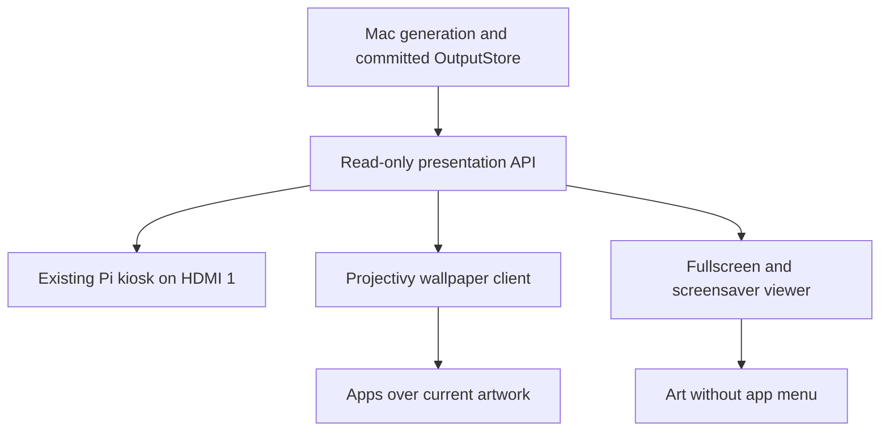
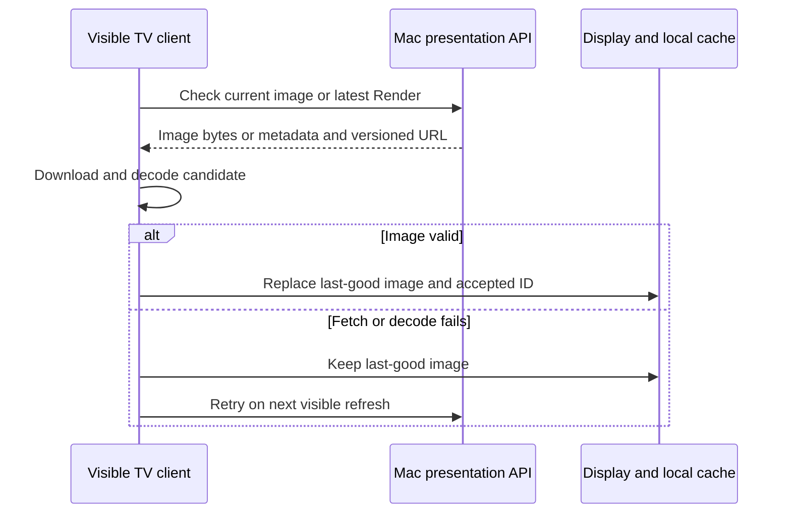
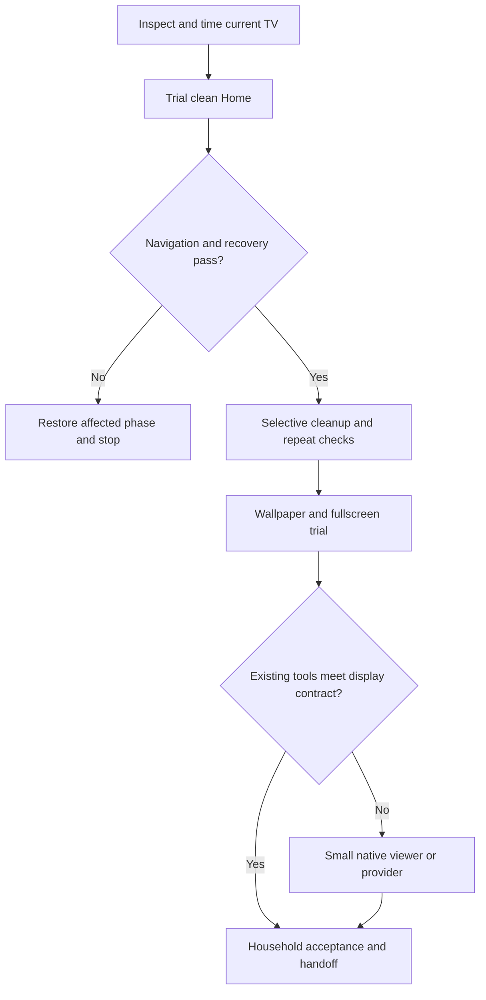

# Sony TV Performance and Haystack Integration - Plan

## Goal Capsule

- **Objective:** The household can navigate the Sony TV quickly, use an ad-free home screen, and enjoy current Haystack artwork without routinely switching inputs.
- **Means:** A measured launcher trial, selective cleanup, then thin TV display clients (KTD1–KTD5).
- **Authority:** Product Contract defines the outcome; Planning Contract defines implementation. Follow `AGENTS.md` for repository and live-system work.
- **Execution profile:** Work one phase at a time. Complete its device checks and report results before starting another phase. The planning request authorizes inspection and this document, not app installation, removal, settings changes, server deployment or automatic execution of every unit.
- **Stop conditions:** Restore the current phase on loss of Home, Inputs, remote, audio, keyboard, a preserved app or casting. Stop on uncertain package purpose rather than guessing.
- **Ownership:** The implementing agent prepares changes and evidence; Andres performs physical TV acceptance and chooses the next phase. Verified repository changes follow the solo-project main workflow. Live rollout stays within the separately authorized phase.

---

## Product Contract

### Summary

Replace the sponsored home experience with a simpler launcher, measure navigation improvements, and reduce unnecessary background work without losing household features.
Then show the same latest Haystack Render behind the app menu, through a fullscreen entry, and during native TV idle time.
Keep the existing Pi display on HDMI 1 as recovery and an alternative viewing path.

### Problem Frame

The household wants faster navigation and fewer home-screen advertisements on a Sony KD-55XE8096.
Haystack currently requires selecting the Pi's HDMI input, separating artwork from everyday TV use.
The viral debloat examples do not establish which Sony packages can safely be disabled or how this TV handles replacement launchers and screensavers.

### Key Decisions

- **Performance and home ad removal are mandatory** (session-settled: user-directed — chosen over treating cleanup as an optional artwork enhancement: these are main goals). Governs R1, R2.
- **Preserve household viewing and casting** (session-settled: user-directed — chosen over broad debloating: used apps and Chromecast must keep working). Governs R3–R5.
- **Keep broadcast TV unless a separate decision changes scope** (session-settled: user-directed — chosen over removing unused-looking tuner services: any significant performance tradeoff must be discussed). Governs R5.
- **Retain the Pi and prefer existing launcher capabilities** (session-settled: user-approved — chosen over immediately building a replacement launcher: phase-by-phase trials allow recovery and limit new software). Governs R6–R9.

### Requirements

**Navigation and advertising**

- R1. Improve measured everyday navigation, while keeping already-fast flows free of material regression. Use engineer-selected before/after comparisons focused on Home navigation, used-app launches, Chromecast and HDMI input selection; owner-selected latency targets are not required.
- R2. Normal Home navigation must show an app menu without sponsored rows, including after restart and standby/wake. This requirement covers home-screen advertising, not advertisements inside streaming apps.

**Household functionality and cleanup**

- R3. Preserve Netflix, Prime Video, YouTube, Spotify, Disney+, Apple TV, the current Max/HBO app, Movistar+, Filmin, RTVE, Atresplayer, Crunchyroll, VLC and Chromecast. Preserve other installed apps until their use is confirmed.
- R4. Remove SkyShowtime in the authorized cleanup phase. Retire obsolete HBO/Max packages only after identifying and successfully opening the current household app. Voice-search components may be disabled when their dependencies are understood; this must not break casting or keyboard input.
- R5. Preserve broadcast TV, HDMI input selection, Pi access, remote/Bluetooth, audio, keyboard, firmware updates, Google dependencies and DRM. A proposal to disable broadcast features requires measured evidence and a new user decision.
- R6. Every TV change must have an exact restore action based on its initial state. Use disable-user for system packages, no root, bootloader unlock or firmware flashing. A package/settings snapshot is configuration evidence, not a complete backup of accounts or app data.

**Artwork delivery**

- R7. Show the newest successful Render as the launcher background and offer a clear fullscreen Haystack entry without requiring HDMI switching. Keep HDMI 1 usable.
- R8. Provide Haystack as a selectable native screensaver for idle TV use if this Sony permits it. Test selection and activation before committing to custom screensaver development. Do not claim that the screensaver overlays all HDMI sources, overrides active playback or displays with the panel off.
- R9. While an artwork surface is visible and the Mac is reachable, show a new successful Render within two minutes of availability. Retain last-good downloaded artwork during delivery failures, and retry a failed image even when its Render ID has not changed. A new owned viewer must retain last-good bytes across restart; external clients must demonstrate equivalent behavior or record the gap before acceptance.
- R10. Keep generation, credentials, canonical artwork, D Continuity, daily-story schedules, retention and public-note contracts on their current paths. TV clients consume presentation data only and never trigger paid generation.

### Success Criteria

Performance acceptance uses repeatable Home, app-grid, Settings and Inputs interactions, plus two representative household apps. Andres also reports slow HDMI channel selection: compare chooser-opening and source-selection-to-stable-picture/audio separately, preserving Pi HDMI 1 and broadcast.
Default to five comparable bounded automated warm probes where practical, report median and slowest, and separate post-restart evidence. Observer timing is optional when available, never an owner prerequisite; unsupported probes remain labelled evidence gaps.
Use repeatable engineering measurements for before/after comparisons; label Android activity timings separately from visible latency. Do not substitute a RAM percentage or reduced animation duration for faster navigation. On 18 October, Andres explicitly removed owner stopwatch trials and target selection as launch gates. Missing human-only observations remain explicit evidence gaps; used-app and Chromecast preservation remain mandatory.
Repeat the same navigation comparisons with art enabled.
R2–R10 and the relevant phase's physical checks must pass independently of the performance result.

### Scope Boundaries

In scope: TV inspection, launcher configuration, selected app/service cleanup, minimum read-only Haystack delivery additions, launcher wallpaper, fullscreen/idle artwork and recovery documentation.

Considered and not built:

- A custom launcher: Projectivy is the first trial; reconsider only if its verified limitations prevent the agreed outcome.
- Bulk debloat scripts or a generic package-scoring engine: one known TV does not justify automatic dependency guesses.
- Blanket cache clearing, force-stopping all services, background-process limits or disabling updates: these do not establish durable responsiveness and can compromise household functions.
- Router port forwarding, internet exposure, cloud-photo mirroring or credential provisioning on the TV: the existing LAN presentation boundary is sufficient.
- Automatic HDMI switching whenever a Render arrives: this would interrupt viewing. CEC remains an optional user-triggered convenience.

Deferred to follow-up work: fixing unrelated Pi kiosk behavior, running generation on the Pi, and changing artwork generation or story scheduling.

### Acceptance Examples

- AE1. After a TV restart, Home opens the clean menu, a preserved streaming app plays with audio, Inputs selects the Pi, and Chromecast still works. Covers R1–R3, R5.
- AE2. A cleanup batch causes a keyboard or casting failure; restore that batch's initial states and repeat the failed action before proceeding. Covers R3, R5, R6.
- AE3. A fixture changes from Render A to B while Home remains visible; the wallpaper changes within two minutes without opening settings. Covers R7, R9, R10.
- AE4. Render B fails to download once; A stays visible and B is retried successfully without requiring Render C. Covers R9.
- AE5. Idle art starts in the verified native-TV context; a remote action returns to usable controls, and active playback is not interrupted. Covers R8.

---

## Planning Contract

### Verified Device Baseline

Read-only ADB inspection on 18 October 2026 confirmed the device at `192.168.0.24:5555` over Ethernet.
The user identifies the retail model as KD-55XE8096; Android reports the generic model `BRAVIA 4K GB` and platform `BRAVIA_ATV2_EU`.
Private raw inspection files are retained in the operator's Haystack TV-inspection folder, outside Git.

| Evidence | Observed value | Consequence |
|---|---|---|
| OS | Android 9, API 28; build suffix `672201` | Use legacy Sony ADB, not modern wireless-pairing assumptions |
| Security patch | 2022-01-05 | Do not disable update components; verify full firmware before suggesting updates |
| Physical RAM reported by kernel | 1,993,356 KiB, about 1.9 GiB | Keep artwork presentation lightweight |
| Package inventory | 198 total, 178 system, 20 third-party; no disabled packages | No pre-existing cleanup was observed |
| Launcher | `com.google.android.tvlauncher/.MainActivity` | This is the current Home component; do not copy Google TV LauncherX commands |
| Launcher PSS, one snapshot | 170,109 KiB, about 166 MiB | A diagnostic baseline, not proof of causation or a guaranteed saving |
| Data storage | 8.1 GiB partition, about 2.0 GiB available | Storage is not exhausted in this snapshot |
| Android UI size | 1920×1080 | Start art decoding at the actual UI size; the panel itself is 4K |
| Screensaver | Backdrop selected, enabled; Colors also registered | Framework support exists; custom-service selection remains untested |
| Timers | screen-off value 3,600,000 ms; sleep timeout -1 | Preserve actual values; do not copy the five-minute sleep setting in social posts |
| Accessibility | Disabled; no enabled services | A launcher accessibility override would be a new setting requiring rollback |
| Animation scales | All three keys absent (`null`) | Rollback must remove newly set values rather than assume 1.0 |

Installed HBO-related packages include `com.wbd.stream`, `com.hbo_android_tv` and `com.hbo.hbonow`.
`com.wbd.stream` is version 7.13.1.2, last updated 9 October 2026, and was present in the process-memory snapshot.
The other two packages are version 1.2.16 (updated August 2023) and 54.25.0 (updated May 2024), respectively.
This makes `com.wbd.stream` the current-app candidate, but version recency and a loaded process do not replace the household playback check.
`com.skyshowtime.skyshowtime.google` is the user-approved removal target.
`tv.samba.ssm`, Sony promotions and recommendation packages are inspection candidates, not an approved disable list.

### Key Technical Decisions

- KTD1. **Compare one intervention at a time.** Test Projectivy alone, cleanup batches, then artwork against the same baseline. Keep animation changes separate so they cannot hide regressions. Implements R1, R2.
- KTD2. **Try supported Home selection before disabling the stock launcher.** Install and open the replacement first, record the exact old component and override settings, and verify restoration. Stock-launcher disabling is an escalation within the launcher phase only after recovery works. Implements R2, R6.
- KTD3. **Use an explicit per-package change ledger.** Capture user-0 enabled-setting values before each batch; restore default, enabled, disabled-user or absent settings exactly. Start with one to three positively identified packages per batch. Uninstall SkyShowtime only after confirming reinstall availability and accepting loss of local app state. Implements R3–R6.
- KTD4. **Reuse existing presentation contracts.** A proposed `GET /api/wallpaper/current` streams the latest valid image with truthful MIME and `Cache-Control: no-store` for direct-image clients. Preserve `/api/latest` JSON and ID-based image URLs. Add the bridge only for the launcher integration, with the existing store and LAN mutation guards unchanged. Implements R7, R9, R10.
- KTD5. **Escalate artwork integration only on observed failure.** Trial Projectivy's remote URL, then its existing Overflight custom image feed if necessary, then a small provider only if those fail freshness/recovery. Trial an Android-9-compatible existing fullscreen/screensaver viewer before introducing an owned Activity/DreamService. Implements R7–R9.
- KTD6. **Keep the Mac as the sole artwork source.** Preserve its existing fixed network identity and reserved `192.168.0.20:4321` address. Do not replace this with mDNS, which has already failed on this LAN. Native Android clients need deliberate HTTP policy for that host; validate external apps' HTTP behavior on-device. Implements R9, R10.
- KTD7. **Separate physical TV acceptance from server tests.** Use temporary fixture images and a separate local fixture server for failure cases; never create paid Renders, alter the live output store or change schedules to test a display. Device restarts, app launches and setting changes occur only in the authorized implementation phase. Implements R1–R10.

### High-Level Technical Design

### Assumptions and Execution Gates

The TV is reachable and authorized for the completed inspection; debugging can be disabled between sessions.
The next implementation launch is limited to the chosen phase, even if later phases have no code dependencies.
No additional approval is required to draft documentation or local code within an authorized phase, but purchasing premium, installing TV apps and deploying a server change need that phase's authority.

The installed-app list does not establish account use or service dependencies.
Package selection and the current HBO/Max app are resolved through user preferences, package metadata and a physical launch check.
Unknown packages remain enabled.

Suggested performance and freshness bounds are planning defaults, with the two-minute display bound adopted by this plan.
The baseline phase uses bounded automated measurements where practical; owner timing-target selection is not a launch gate. Missing physical observations prevent claims about visible latency, playback, casting or verified recovery, but do not block independent preparation.

The native screensaver branch is conditional on this TV exposing a working selectable third-party DreamService.
Test this with an existing compatible service before building custom code; if blocked, keep fullscreen and Pi art usable and return the screensaver limitation for a user decision.

### Sources and Existing Patterns

- `src/server/server.ts`: allowlisted presentation metadata, `/api/latest`, `/api/outputs/:id`, and loopback-only mutation boundary.
- `src/storage/output-store.ts`: latest valid committed output and purge behavior; ID URLs are not permanent archives.
- `public/kiosk.html`: thin polling client and crossfade. Its accepted-ID-before-load behavior has a retry gap; new clients must satisfy AE4 rather than copy it.
- `tests/server/server.test.ts` and `tests/storage/output-store.test.ts`: presentation, MIME, retention and LAN-boundary test patterns.
- `docs/solutions/integration-issues/raspberry-pi-kiosk-hardcoded-mac-ip.md`: preserve the fixed private Wi-Fi identity and DHCP reservation.
- [Sony exact-model specifications](https://www.sony.co.uk/electronics/support/televisions-projectors-lcd-tvs-android-/kd-55xe8096/specifications): LCD, 2017 model, Android TV and HDMI-CEC support.
- [Sony downloads](https://www.sony.co.uk/electronics/support/televisions-projectors-lcd-tvs-android-/kd-55xe8096/downloads): v6.7220 listed at research time; the photo alone is not firmware verification.
- [Projectivy releases](https://github.com/spocky/miproja1/releases): 4.72 was current during research; use a stable Android-9-compatible release, record actual version and premium terms.
- [Wallpaper-provider API](https://github.com/spocky/projectivy-plugin-wallpaper-provider): wallpaper timing and item-cache TTL are separate controls.
- [Overflight](https://github.com/spocky/projectivy-plugin-wallpaper-overflight): JSON/M3U image feeds, not a screensaver.
- [Android DreamService](https://developer.android.com/reference/android/service/dreams/DreamService) and [network security configuration](https://developer.android.com/privacy-and-security/security-config): service lifecycle and cleartext HTTP policy.
- [ADB](https://developer.android.com/tools/adb), [UAD-ng](https://github.com/Universal-Debloater-Alliance/universal-android-debloater-next-generation/wiki), [Cobanov](https://tv.cobanov.dev/) and [tv-vibehack](https://github.com/Gathin23/tv-vibehack): operational references; their example package lists are not Sony approvals.

---

## Implementation Units

Each U-ID is a phase boundary. Operational units produce a runbook and evidence rather than inventing application code or unit tests for manual TV actions.

### U1. Complete baseline and recovery preparation

**Goal:** Turn the completed read-only inspection into an actionable device profile and repeatable comparison.
**Requirements:** R1, R3–R6, R10.
**Dependencies:** None; inspection is complete, timed baseline and recovery confirmation remain.
**Files:** Create `docs/tv-integration.md`; update `.gitignore` to exclude `tv-local/` before storing any local run evidence there. Keep private snapshots outside Git.
**Approach:** Record the verified baseline above, preserve user preferences, capture exact settings/package states before touching them, and establish how to return to stock Home and Pi input. Select practical engineering comparisons without requiring owner stopwatch trials or timing-target selection. Do not claim a snapshot can recover lost app data or a boot loop.
**Execution note:** Device timings and recovery readiness are the first proof; no production tests are needed for documentation alone.
**Test scenarios:** Capture bounded automated Home, Settings, Inputs and two chosen app-launch probes, aiming for five comparable warm samples where practical; separate restart and wake technical checks. Attempt a bounded D-pad delivery probe only where reliable. Keep animation values fixed. Observer timing is optional, never owner stopwatch work or a preparation gate. Record visible focus, actual casting, keyboard, audio and Pi picture as explicit gaps until observed; automated success cannot establish these physical outcomes.
**Verification:** Reproducible available baseline evidence and its limits are recorded, exact original states are available, and the household preservation list is unambiguous. Record unobserved physical acceptance separately; do not claim it passed. No app or package changes are required to finish baseline recording.
**Rollback:** Disconnect ADB on the Mac; ask Andres to disable debugging when finished with the session. No TV rollback is needed for the read-only inventory.

### U2. Deliver and measure the ad-free launcher

**Goal:** Make normal Home ad-free while preserving recovery and household controls.
**Requirements:** R1–R3, R5, R6; AE1.
**Dependencies:** U1.
**Files:** Update `docs/tv-integration.md`; local-only launcher settings and timing evidence in `tv-local/`.
**Approach:** Follow KTD1–KTD2. Install the verified stable Projectivy version, start with a static background and household app shortcuts, then set the supported Home/default/override route. Test whether accessibility override is needed instead of enabling it by default. Do not purchase premium until the required feature and price are known.
**Test scenarios:** Home and Back from two apps; Settings and Inputs; Pi HDMI; keyboard, volume/audio, cast start/stop; five comparable warm timings; restart and standby/wake. Verify no stock-home ad flash in ordinary return paths and no lost remote shortcuts.
**Verification:** AE1 passes and R1 comparisons demonstrate improvement without material regression, or the measured remaining gap is explicitly carried into U3. Ad removal alone does not close R1.
**Rollback:** Restore exact Home component and override/accessibility values, verify stock Home and Inputs, then remove the trial launcher only when restoration works.

### U3. Perform selective cleanup without losing viewing features

**Goal:** Remove SkyShowtime and demonstrated unnecessary background work, then verify speed and stability.
**Requirements:** R1, R3–R6; AE2.
**Dependencies:** U2.
**Files:** Update `docs/tv-integration.md`; private package-state ledger and measurements in `tv-local/`.
**Approach:** Follow KTD3. Confirm the current HBO/Max package through metadata and a household launch before retiring duplicates. Treat voice search, Sony promotions, Samba and recommendations as separately researched candidates. Preserve broadcast and casting. Record the expected benefit of each batch and compare it with the U2 state; do not retain a change solely because its package name looks unnecessary.
**Test scenarios:** AE2; original-state restoration of one changed package and one absent setting; current Max playback after duplicate retirement; casting and broadcast checks; U2 control checks after each batch; final restart/wake and normal viewing session. Separate any approved animation trial from package changes.
**Verification:** SkyShowtime is removed as requested, preserved apps work, and final navigation meets R1. If measured gains are inadequate, report the limitation and propose a bounded next decision rather than disabling progressively less-understood services.
**Rollback:** Restore the last batch first and retest the failing function. Reinstall SkyShowtime through its confirmed source if requested; any account/login state must be restored by the user.

### U4. Add the minimum read-only wallpaper delivery bridge

**Goal:** Give direct-image wallpaper clients a current-image URL without changing generation behavior.
**Requirements:** R7, R9, R10.
**Dependencies:** U3, including its household checks and report. Live activation belongs to the separately authorized artwork phase.
**Files:** Modify `src/server/server.ts` and `tests/server/server.test.ts`; update `docs/tv-integration.md`.
**Approach:** Implement KTD4 using existing OutputStore resolution and stream handling. The endpoint returns bytes, not a metadata JSON document or a public filesystem mount. Keep generic errors and truthful MIME. Handle a purge race as a controlled failure. Avoid a conversion subsystem unless the TV demonstrates a format/size problem.
**Test scenarios:** Empty store; newest valid output switches after a second save; real PNG/JPEG/WebP bytes and MIME; no-store policy; corrupt/missing newest output and purge race; generic failures without local paths; LAN GET allowed while paid mutation remains rejected. Use temporary fixture storage.
**Verification:** Focused server/storage coverage and build pass. Existing presentation contracts remain unchanged. No paid generation or resident server restart is needed for local proof.
**Rollback:** Remove the configured TV URL and revert the bridge deployment; existing kiosk and ID-image routes remain usable.

### U5. Show current artwork behind the app menu

**Goal:** Meet R7 and R9 with the least additional software.
**Requirements:** R1, R7, R9, R10; AE3, AE4.
**Dependencies:** U3, U4.
**Files:** Update `docs/tv-integration.md`; if required, add the Overflight image-list adapter and tests in `src/server/server.ts` and `tests/server/server.test.ts`. A custom provider, only if justified, belongs under `android-tv/` with provider tests alongside its sources.
**Approach:** Apply KTD5 in order. Start with the raw URL and fixture images. If unchanged-URL caching fails, test an Overflight feed with absolute ID-based image URLs. If that fails, build a single-item provider using the existing JSON presentation API and explicit item-cache expiry. Record why each escalation was needed before building it. Test external apps' HTTP policy and cache behavior rather than assuming response headers force refresh.
**Test scenarios:** AE3 and AE4; remain on Home across two updates; leave/return to Home; Mac unavailable; cold start with saved art; corrupt image; old output purged; return after standby. Compare navigation timings with art enabled and verify crop on the 1080p UI.
**Verification:** New artwork visibly arrives inside R9's bound and does not erase responsiveness gains. Offline behavior is demonstrated; do not silently accept a blank background as success.
**Rollback:** Restore the known static wallpaper and provider settings. Remove only the integration installed in this phase; retain clean Home and completed cleanup.

### U6. Deliver fullscreen and idle artwork

**Goal:** Offer a Haystack tile and a verified native idle-art path.
**Requirements:** R1, R7–R10; AE4, AE5.
**Dependencies:** U5.
**Files:** Update `docs/tv-integration.md`. If an existing viewer meets the contract, no Android code is needed. Otherwise create an isolated Gradle application under `android-tv/` with `AndroidManifest.xml`, a shared image repository/cache, fullscreen Activity, DreamService, network-security configuration, JVM cache tests and device lifecycle tests.
**Approach:** Trial an existing Android-9-compatible URL/fullscreen/screensaver viewer only after verifying its documented capabilities, permissions and source. Use the unchanged kiosk URL for fullscreen trials where supported. Verify a third-party screensaver can be selected and started before custom development. For owned code use native image display, a common last-good file cache and the allowlisted API; no engine imports, background generation or continuous polling while hidden. Fetch/decode off the main thread and release lifecycle work on exit. Keep last-good bytes until the new image is valid.
**Test scenarios:** Tile opens fullscreen without input switching; Back/Home exits; AE4 and AE5; select/start screensaver; idle from Home; paused and active playback; HDMI context; standby/wake; cold offline launch with and without a cache; relative URL resolution and host-scoped HTTP; PNG/JPEG/WebP and actual production dimensions; lifecycle cancellation and bounded bitmap memory.
**Verification:** Activity and screensaver behavior are observed independently. Record supported contexts and exact idle/sleep settings. If the Sony blocks third-party screensavers, stop that branch and obtain a decision on the documented limitation; fullscreen alone is partial delivery.
**Rollback:** Restore Backdrop and original timers, remove the viewer/provider if installed, and confirm Home and Pi display still work.

### U7. Household acceptance and operational handoff

**Goal:** Leave a documented, usable system after ordinary viewing and a recovery rehearsal.
**Requirements:** R1–R10.
**Dependencies:** U6, or an explicit user decision accepting a documented screensaver limitation.
**Files:** Finalize `docs/tv-integration.md`, relevant `AGENTS.md` operating notes, and `.claude/tasks/tasks.md` phase progress. Do not place execution checkboxes in this plan.
**Approach:** Record installed versions, retained/changed packages, the final Home route, artwork sources, observed screen contexts and restore procedure. Confirm current Pi URL and fixed Mac address. Test CEC only as a separately selected convenience; no unsolicited source switching. Remove failed-experiment code and installations after confirming the accepted path.
**Test scenarios:** Normal household session; restart and standby/wake; current artwork change; Mac sleep/network loss/recovery; cleanup rollback rehearsal using a harmless already-approved change; debug-off reconnection rejection; Pi fallback.
**Verification:** Product acceptance and R1 metrics are recorded, restore evidence is complete, ADB host is disconnected, and Andres has disabled debugging on the TV after the session. Disabling TV debugging is a user action, not something inferred from host disconnection.

---

## Verification Contract

| Phase | Proof | Exit condition |
|---|---|---|
| U1 | Recorded on-device baseline and recovery states | Available automated baseline captured; physical gaps explicit; no owner target-selection gate |
| U2 | Physical control/stream/cast checks and timings | Clean Home survives restart/wake; no core regression |
| U3 | Per-batch state ledger and before/after evidence | R1, R3–R6 pass; no speculative bulk disable |
| U4 | `npm run build`; focused Vitest server/storage run; `npm run test:run` for shared-server changes | New route and existing LAN boundaries pass |
| U5 | Fixture server, two changed images and offline recovery on physical TV | AE3, AE4 and art-enabled navigation pass |
| U6 | Installed-viewer checks or owned Android JVM/device tests | Fullscreen and selected screensaver lifecycle pass separately |
| U7 | Ordinary viewing and restart/network/recovery rehearsal | All accepted outcomes and exact rollback documented |

No application tests were run as part of writing this plan.
U1 now records bounded Android activity timings in docs/tv-integration.md; visible remote-to-ready latency and playback/casting acceptance remain unverified. The memory snapshot is not a speed benchmark.
The repository has a lint script but no verified lint configuration in this planning run; do not describe lint as passed without running a working configuration during code implementation.
Android build/test commands are recorded when the owned-app branch pins its actual SDK/Gradle toolchain; no Android tooling currently exists in this repository.

---

## Definition of Done

Every accepted implementation phase has its evidence and restore action recorded in `docs/tv-integration.md`, with progress tracked in `.claude/tasks/tasks.md`.
The final system meets R1–R10, or a specific unmet outcome is returned for a user decision and is not marked complete.
No preserved household function regresses, and artwork uses the same committed Renders as the Pi without extra generation.
Local code passes the applicable Verification Contract before deployment.
Abandoned experimental code and installations are removed, private snapshots remain outside Git, and no broad debugging access is left enabled after handoff.
