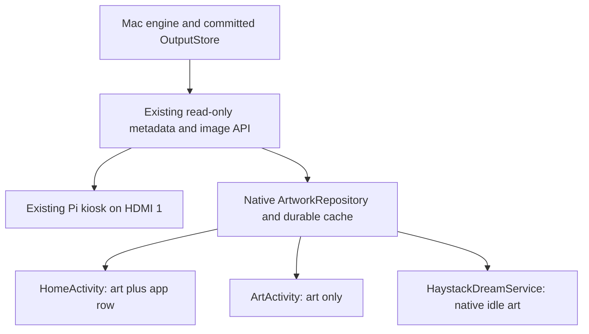
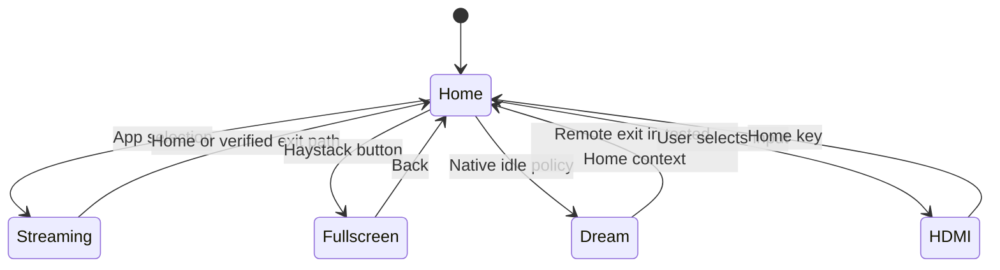
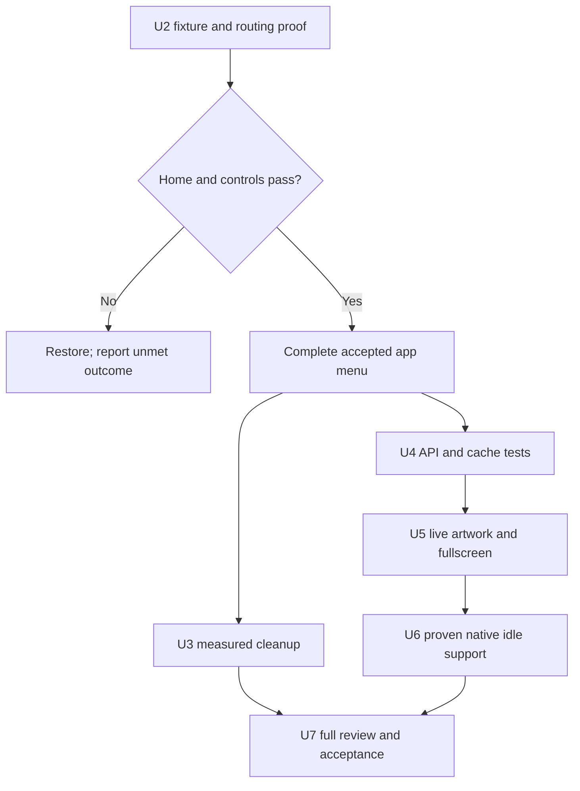

# Sony TV Performance and Haystack Integration - Plan

## Goal Capsule

- **Objective:** The household can navigate the Sony TV quickly, use an ad-free Home, and see current Haystack artwork behind its apps or fullscreen without switching inputs.
- **Means:** Prove Sony routing and display compatibility first, then build a small free native TV client using the supplied launcher source where useful (KTD1–KTD7).
- **Authority:** This is a revised proposal for review, not approval of its recommended launcher architecture or permission to resume live implementation. The earlier Projectivy route is withdrawn. The heartbeat remains paused.
- **Execution profile:** Implement one separately authorized unit at a time. Document-only planning does not authorize installations, live navigation, settings, cleanup or server deployment. Do not resume the earlier trial under its previous away-from-home authorization.
- **Stop conditions:** Restore the affected trial on lost Home, Inputs, controls, audio, keyboard, a used app or casting. Stop on unknown dependencies, paid feature requirements or unsuccessful recovery.
- **Ownership:** The implementer supplies measured evidence and exact recovery; the orchestrator reviews actual outcomes before reporting acceptance. Physical-only gaps remain explicit without making the owner operate a benchmark questionnaire.

---

## Product Contract

### Summary

Replace the sponsored Home with a fast app menu over the latest Haystack Render.
A visible Haystack button opens the same artwork without the app menu; the native idle screensaver can show it where Sony permits third-party dreams.
The Pi remains available on HDMI 1, with no new software purchase or subscription required for any of these display features.

### Problem Frame

The Sony KD-55XE8096 has unwanted Home advertising and slow navigation, app launching and input selection.
Haystack currently lives behind a separate HDMI input.
The previous recommendation introduced Projectivy without establishing free custom-art support or reliable default-Home routing on this Sony; its live trial was restored and remains unaccepted.

### Key Decisions

- Performance and Home ad removal are mandatory user requirements, not optional artwork improvements. Governs R1–R2.
- Preserve household apps, Chromecast and broadcast TV; the user only approved removing SkyShowtime and conditionally retiring genuinely obsolete Max/HBO copies. Governs R3–R6.
- Free custom imagery is required by the user's correction. Neither Projectivy nor a preference for existing launchers is a settled user choice. Governs R7–R11.

Product Contract preservation: R1–R10 retain their core outcomes; R7–R9 clarify interaction and idle limits; R11 adds the explicit no-new-display-software-fees requirement. The earlier existing-launcher preference was incorrectly labelled user-approved and is removed. The native-client recommendation below is a proposal.

### Requirements

**Speed and advertising**

- R1. Improve everyday Home navigation and used-app launch responsiveness without material regression to Chromecast or input switching; measure comparable before/after actions rather than RAM alone.
- R2. Normal Home and return paths show no sponsored rows, including after restart and standby/wake; this excludes ads inside streaming apps.

**Preservation and recovery**

- R3. Preserve Netflix, Prime Video, YouTube, Spotify, Disney+, Apple TV, current Max/HBO, Movistar+, Filmin, RTVE, Atresplayer, Crunchyroll, VLC and Chromecast; leave other unconfirmed apps intact.
- R4. Remove SkyShowtime only in U3; retire obsolete HBO/Max packages only after the actual used app works and recovery is established. Unused voice search is a research candidate, not permission to disable shared dependencies.
- R5. Preserve broadcast, HDMI/Inputs, Pi HDMI 1, remote/Bluetooth, audio, keyboard, updates, Google dependencies and DRM. Broadcast removal requires significant measured benefit and a separate decision.
- R6. Every changed setting, package/component state and app installation has an exact restore action from a fresh initial-state ledger; no root, bootloader unlock or firmware flashing. Configuration snapshots are not full account/app-data backups.

**Artwork and cost**

- R7. Home shows current Haystack artwork behind the app menu, with an explicit Haystack action opening fullscreen art and Back returning to the menu; HDMI 1 remains an alternative.
- R8. Offer a selectable native Haystack screensaver if Sony permits third-party DreamService selection and idle activation; report a failure as a limitation requiring a scope decision, not a completed screensaver. Do not interrupt playback, switch HDMI automatically or claim universal HDMI-idle activation or panel-off display.
- R9. While a display surface is visible and the Mac is reachable, show a new successful Render within two minutes; retry failed downloads even if the Render ID is unchanged. Retain last-good bytes across network failures and restarts, with a harmless built-in background when no cache exists.
- R10. Keep generation, credentials, canonical artwork, D Continuity, schedules, retention and public-note contracts unchanged; TV clients only read presentation data and never trigger generation.
- R11. Home, arbitrary custom artwork, automatic refresh, fullscreen and screensaver must require no new paid licence, subscription or cloud-photo service; existing Haystack generation costs remain unchanged. Any candidate failing this requirement is rejected before installation.

### Key Flows and Acceptance Examples

- F1 / AE1. Home opens the app menu over Render A; select Netflix, return Home and use Back exit paths. Clean Home persists through restart and standby/wake. Covers R1–R3, R5.
- F2 / AE2. From Home select Haystack: only artwork appears; Back restores the app menu and useful focus. Selecting HDMI 1 still shows the existing Pi. Covers R5, R7.
- F3 / AE3. Render B appears on the server while Home/fullscreen/dream is visible; each surface displays B within two minutes. With the Mac asleep, A remains visible after process/device restart. Covers R7–R10.
- F4 / AE4. B downloads unsuccessfully or is purged between metadata and fetch; A stays visible and B is retried without waiting for C. Corrupt bytes never replace the cache. Covers R9.
- F5 / AE5. Sony enters the selected dream during a proven idle context; a remote action exits to usable controls. Streaming/casting playback and existing power policy are preserved. Covers R5, R8.
- F6 / AE6. A cleanup batch breaks a preserved feature; restore only that batch's exact original states and recheck before proceeding. Covers R3–R6.

### Scope Boundaries

In scope: one Sony-specific native display client, ad-free Home routing, selective measured cleanup, read-only artwork delivery, fullscreen and native idle art, verification and recovery.
A live HDMI video feed underneath a native app grid is not the proposed background: Home fetches the same Render over LAN. The Pi cannot directly launch Android Netflix or draw into Sony Home merely because it is connected by HDMI.

Not included: automatic HDMI switching on image arrival; a generic launcher product; themes/store/accounts/plugins; Pi-side generation; paid launchers; blanket debloat lists; firmware work; arbitrary accessibility automation; changing schedules or fixing unrelated Pi kiosk code.
Stock-launcher disabling is outside current authority. If a proper persistent Home cannot be established without it, restore and return a concrete escalation proposal rather than run disable commands from the supplied guides.

---

## Planning Contract

### Verified Baseline and What Remains Unknown

The TV is Sony KD-55XE8096, Android 9/API 28, UI 1920×1080, about 1.9 GiB RAM; the original inventory contained 198 packages.
Stock Home is `com.google.android.tvlauncher/.MainActivity`; Ethernet ADB was `192.168.0.24:5555` during inspection.
The Mac serves the existing kiosk at `http://192.168.0.20:4321`; preserve its fixed private Wi-Fi identity/reservation. The extender no longer exists.
Read `docs/tv-integration.md` for exact state and prior evidence rather than copying absent animation settings to literal 1.0.

The Projectivy attempt proved ordinary installation, not accepted Home replacement: the preferred-Home setter returned success but HOME still resolved to stock. Injected settings input was unreliable; physical remote incompatibility was never established.
Projectivy was removed and 198 package IDs, all 287 captured settings entries and stock component states matched the fresh trial baseline. Actual casting playback failed in a fixture attempt without an earlier successful playback baseline; this is not proof of a regression.
No replacement Home, visible speed improvement, DRM/audio/cast acceptance or custom screensaver is established. Android activity timings and screenshots cannot establish all those outcomes.

### Alternatives and Source Evidence

| Approach | Verified supplied capability | Missing for this request | Decision |
|---|---|---|---|
| Keep stock Home + Pi | Existing viewing and HDMI artwork path | Ad-free Home and integrated background | Recovery state; incomplete outcome |
| FLauncher | GPLv3+ Flutter app grid, free manually chosen file wallpaper | Hourly LAN image fetch/cache and owned fullscreen/dream; Sony Home routing still unproven | Free static fallback for a separately agreed reduced scope |
| Adapt tv-vibehack | MIT native Java app grid, minSdk 26/target 29 in inspected source | Source has no network client, hourly artwork, fullscreen art or DreamService; app/input shortcuts need adaptation | Recommended starting point after bounded compatibility proof |
| Projectivy | Ordinary launcher trial installed then removed | Custom wallpaper is Premium; Home routing unaccepted | Excluded from this proposal |

The [tv-vibehack manifest](https://github.com/Gathin23/tv-vibehack/blob/19f3c224fe68843cb2ff0df3157b81622bbe1266/launcher/app/src/main/AndroidManifest.xml) declares neither Internet access nor a dream service. Its [configuration](https://github.com/Gathin23/tv-vibehack/blob/19f3c224fe68843cb2ff0df3157b81622bbe1266/launcher/app/src/main/res/values/config.xml) contains Xiaomi/MediaTek defaults that require Sony adaptation.
The tv-vibehack sample is reference code, not an install-and-finish solution or a Sony compatibility guarantee.
Its bundled build/install script disables stock Home and its restore script writes animation defaults; neither may be executed.
FLauncher's wallpaper is copied from a selected file into private storage; replacing a similarly named external file is not a verified refresh mechanism. Its ambient action starts the system screensaver, not an included Haystack dream.
FLauncher also includes Firebase analytics/crash configuration; using an off-the-shelf package does not remove review or maintenance work.
The tradeoff is explicit: a native client gives free control of artwork and interactions but creates a small Android codebase, signing key, SDK build and maintenance obligation. No performance gain is guaranteed by source size.

### Why Recommend the Native Adaptation

**Option A — keep stock Home and the Pi.** This has the lowest maintenance cost and preserves the working separation of TV apps and artwork. A user-triggered input shortcut could reduce steps, but this path leaves sponsored Home and cannot put the Pi's HDMI image behind Sony's native app menu. It is the recovery choice, not a solution to the full request.

**Option B — use FLauncher and add artwork separately.** This provides a free app grid and manual wallpaper without writing that menu ourselves. To meet R7–R9 we would still need either a maintained FLauncher fork with image-fetch/cache integration plus fullscreen/dream code, or accept that the wallpaper stays manual while a companion app handles the other surfaces. A companion app alone has no verified way to refresh FLauncher's private wallpaper file. The full fork route is viable, but couples Flutter/Firebase maintenance to a native Android companion and remains subject to Sony Home routing. GPL compliance is manageable but must be respected if distributing a fork.

**Option C — adapt the supplied native tv-vibehack launcher.** This starts with an app menu in the same platform as the required fullscreen and DreamService components. One cache can feed all three surfaces without an undocumented wallpaper handoff. It requires more new image-delivery code than a static FLauncher install, but avoids maintaining a Flutter fork plus a separate native integration. The recommendation concerns fit and code ownership, not a proven speed advantage. Keep the adaptation small and remove unsupported Xiaomi assumptions.

**Option D — write an entirely new native launcher.** It offers the same control as C, but repeats app-grid and remote-focus work already available under MIT. Only take this route if source review reveals that adapting the sample costs more than replacing its small UI; do not grow a generic launcher framework.

**Option E — Projectivy or another paid wallpaper extension.** This may reduce code ownership but conflicts with R11. No purchase or further trial is proposed, and a free install is not evidence of free required features.

**Recommendation: C, conditional on the early compatibility gate.** The specific reason is that Home, fullscreen and native idle can share one small Android implementation and durable image cache. Neither C nor B is known to bypass Sony's Home policy; if U2 cannot establish acceptable Home and recovery within its bounded session, stop and explain the limitation before investing further. If the user chooses only a static free menu plus Pi art, B becomes the smaller solution, but that reduced outcome must be chosen explicitly rather than substituted for R7–R9.

### Key Technical Decisions

- KTD1. **Gate the architecture before the build.** U2 records two separate results: the mandatory Home/routing/control proof, and native dream capability. Failure of dream selection must not prevent testing Home; it leaves R8 unresolved. Test ordinary app mode before default routing. The live compatibility experiment has a total 30-minute budget, excluding necessary restoration. Attempt only a supported chooser and, if new evidence justifies it for this component, one preferred-Home setter; skip known-ineffective repetition. On budget exhaustion restore and report. A separately proposed accessibility trial is not an automatic extension. Implements R1–R2, R5–R8, R11.
- KTD2. **Preserve stock recovery.** Try supported Home selection with actual resolution/physical Home/Back evidence. A minimal dedicated Home accessibility interception may only be trialled if its precise behavior and permission are included in the next phase authorization; never silently grant access or remap volume. An interception with stock ad flashes or broken task routing fails R2. No stock disabling, root or launcher-manager installation is authorized. Implements R2, R5–R6.
- KTD3. **Keep cleanup independent and attributable.** Use one to three positively identified packages per batch with exact enabled-state recovery; remove SkyShowtime only with reinstall availability and app-data loss understood. Compare against the accepted clean menu, not a mixed launcher/art/cleanup change. Implements R1, R3–R6.
- KTD4. **Reuse existing GET contracts.** `src/server/server.ts` already supplies allowlisted `/api/latest` metadata with a relative `imageUrl` and `/api/outputs/:id` image bytes; no wallpaper bridge or public filesystem route is initially needed. A fixture server supplies deterministic A/B/error cases without touching production outputs. Implements R9–R10.
- KTD5. **One native client, three display surfaces.** Propose `android-tv/`, a small Java Android app with HomeActivity, ArtActivity and HaystackDreamService sharing an ArtworkRepository and app-private durable cache. No browser engine, wallpaper-provider plugin, billing SDK, analytics or permanent foreground service. Adapt useful MIT layout code with attribution; resolve installed TV launch intents dynamically, keep all apps reachable, and verify Sony Settings/Inputs intents instead of copying Xiaomi ones. Implements R3, R5, R7–R11.
- KTD6. **Refresh only visible surfaces.** Poll metadata every 60 seconds while any surface is visible, refresh on entry/resume and stop when hidden; one shared in-flight fetch. Resolve image URLs against the configured Mac origin, reject foreign origins/redirects, configure Android cleartext HTTP only for the selected LAN host, and perform networking/decoding off the UI thread. Bound downloads to 32 MiB and 40 megapixels before sampled decoding to the 1080p UI; validate actual fixture/production formats against those caps. Persist candidate bytes and ID transactionally before publishing; cancellation, malformed bytes, 404 and decode failure keep the prior accepted image. Implements R1, R9–R10.
- KTD7. **Use the actual dream lifecycle.** Register a DreamService using the framework binding permission and selection metadata; never ask for broad secure-settings authority. Prove selection, natural idle entry, input exit and restart persistence separately from forced preview. Do not emulate system idle by overlaying other apps or forcing HDMI switches. Implements R5, R8.

### High-Level Technical Design

These diagrams describe the proposed responsibilities, not existing shipped functionality.



```mermaid
sequenceDiagram
  participant Surface as Visible surface
  participant Cache as Shared artwork repository
  participant API as Mac API
  Surface->>Cache: Attach; display cached image immediately
  Cache->>API: GET latest, then candidate image
  API-->>Cache: Metadata and bounded image bytes
  alt Valid decoded candidate
    Cache->>Cache: Durable atomic commit, then publish accepted ID
    Cache-->>Surface: Render new image
  else Failure or cancellation
    Cache-->>Surface: Retain last-good image
    Cache->>Cache: Retry on next visible poll even with unchanged ID
  end
```





A shared native view fits the full image without an automatic crop; a small bottom app strip overlays Home, with a subtle contrast scrim and visible D-pad focus. The Haystack button opens art without app controls. Input selection remains explicit; no unconfirmed dedicated remote-button remapping is promised.

### Dependencies and Execution Gates

U2 is a bounded implementable feasibility unit; U3–U7 are conditional on its results and separate authority. No one is claiming end-to-end Sony support now. If routing fails, restore and let the user choose whether to pursue a separately specified escalation, accept a reduced scope or stop; no fallback installation or architecture change happens automatically.
A failed dream capability does not invalidate an independently successful Home/fullscreen route, but R8 stays unresolved until the user accepts a limitation or another approach.
A failed default-Home route prevents an accepted ad-free Home: FLauncher and a custom UI do not automatically bypass the same Sony policy.
Android build tools, minSdk/API compatibility, production image caps and signing reproducibility are checked locally before any installation. Keep private signing keys outside Git and record a stable public certificate fingerprint for updates.
Do not start a platform rewrite or add another launcher after failure without presenting the new tradeoff.

### Effort and Maintenance Tradeoff

These are rough engineering planning allowances, not elapsed-time or delivery promises; the Android toolchain has not yet been built in this repository.
Allow 2–4 hours for source adaptation, local SDK/build/signing setup and the minimal fixture app, then at most the 30-minute live experiment in KTD1 plus whatever time safe restoration requires. Do not build the full client while that gate is unresolved.
If it passes, allow roughly 1–3 additional engineering days for the menu, shared delivery/cache, fullscreen/dream lifecycle and automated checks, plus a separate household verification window. Re-estimate from the working stub before authorizing those units; package cleanup time depends on demonstrated dependencies.
There are no new display-software licence fees, but the project owns the signing key, reproducible build, occasional Android/build-tool compatibility updates and fixes if a TV firmware or Haystack API change breaks the client. A free static FLauncher install needs less custom development if the user explicitly prefers the reduced outcome.

### Sources and Existing Patterns

- [tv-vibehack source at 19f3c224fe68843cb2ff0df3157b81622bbe1266](https://github.com/Gathin23/tv-vibehack/tree/19f3c224fe68843cb2ff0df3157b81622bbe1266): MIT native Java sample; its bundled Outfit font has a separate SIL OFL notice. Preserve applicable notices when copying selected files.
- [FLauncher official source at 4930cd738a5ab32967953fe8b12790bc4b452872](https://gitlab.com/flauncher/flauncher/-/tree/4930cd738a5ab32967953fe8b12790bc4b452872): GPLv3+ Flutter launcher; candidate comparison only, no GPL source is proposed for copying into the MIT-derived client.
- [Cobanov guide](https://tv.cobanov.dev/): FLauncher and conservative non-root cleanup inspiration; its generic launcher-disable/cache/animation recipe is not a Sony runbook.
- [Original UAD](https://github.com/0x192/universal-android-debloater): package-description research only, never a blanket approved list.
- [Android TV app setup](https://developer.android.com/training/tv/get-started/create), [DreamService](https://developer.android.com/reference/android/service/dreams/DreamService), [network security configuration](https://developer.android.com/privacy-and-security/security-config): platform contracts, not device acceptance.
- `src/server/server.ts`: `toPresentationMetadata`, GET latest/image routes and loopback-only mutations; `src/storage/output-store.ts`: validated committed-image resolution and purge races.
- `public/kiosk.html`: 60-second polling precedent; do not copy its accepted-ID-before-image-load retry gap or assume durable offline caching exists there.
- `tests/server/server.test.ts`, `tests/storage/output-store.test.ts`: MIME, metadata allowlist, traversal, empty/latest and LAN permission tests.
- `docs/solutions/integration-issues/raspberry-pi-kiosk-hardcoded-mac-ip.md`, `CONCEPTS.md`: fixed LAN identity and Render/Kiosk vocabulary.

---

## Implementation Units

### U1. Reuse baseline and refresh exact recovery before a new trial

**Requirements:** R1, R3, R5–R6. **Files:** `docs/tv-integration.md`, `.claude/tasks/tasks.md`; private evidence under ignored `tv-local/`.
Use existing inventory and restoration work; do not repeat hours of exploration. At the next authorized live session record fresh settings presence/values, package/component enabled states, preferred Home, dream selection and installed trial apps. Re-establish current casting playback before attributing a later failure to the trial.
**Verification:** Record what is observed vs missing; do not claim that prior package/settings equality verifies audio, DRM or HDMI picture. No new feature tests apply to this documentation/evidence unit.

### U2. Prove Sony compatibility, then complete the clean app menu

**Requirements:** R1–R3, R5–R8, R11. **Decisions:** KTD1–KTD2, KTD5, KTD7. **Depends on:** fresh U1 recovery and explicit authorization of the revised trial.
**Proposed files:** `android-tv/settings.gradle`, `android-tv/build.gradle`, `android-tv/app/build.gradle`, `android-tv/app/src/main/AndroidManifest.xml`, Java sources under `android-tv/app/src/main/java/dev/haystack/tv/`, resources, `android-tv/THIRD_PARTY_NOTICES.md`, `android-tv/README.md`, `docs/tv-integration.md`.
First build only the smallest inspectable app with fixture wallpaper, a few launchable TV-app entries, Settings/Inputs, fullscreen and a minimal dream. Pin the upstream source commit, retain MIT notices, use a distinct package `dev.haystack.tv`, establish minSdk 26/API-28 compatibility and verify release signatures locally. Exclude upstream install/restore/debloat scripts.
During the KTD1-bounded live session, first prove physical remote controls and fixture display, then supported Home routing. Test Home/Back, restart and standby/wake before developing the full menu. Record dream selection/preview as a separate capability result; a rejected dream does not block gathering the Home result, but R8 remains unresolved. Natural idle acceptance belongs to U6. If routing needs accessibility, present the exact proposed service before enabling it; if still blocked, restore and report the blocker rather than leave a novelty app installed as completion.
Only after the Home gate passes and any failed dream capability has been returned for a user scope decision, finish configurable order for all 13 preserved apps, an all-apps route, Haystack, Settings and Inputs. Keep stock recovery reachable. No art network integration or cleanup yet.
**Proposed tests:** `android-tv/app/src/test/java/dev/haystack/tv/AppCatalogTest.java`; `android-tv/app/src/androidTest/java/dev/haystack/tv/HomeNavigationTest.java`.
**Scenarios:** Installed/absent/renamed app fallback; current Max vs old copies; D-pad focus and Back return; no accidental launch while moving focus; missing or rejected Sony input intent still leaves physical Inputs/Settings reachable; fullscreen/dream exits; repeated Home/app exit with no stock ad flash; stock restoration after each routing attempt.
**Verification:** Build/lint/unit tests plus API-28 emulator interaction; actual Sony routing/restart/wake/controls and dream capability are separate live evidence. All-app launch success is not DRM playback acceptance. Record the gate before completing the menu.

### U3. Perform measured selective cleanup

**Requirements:** R1, R3–R6. **Decision:** KTD3. **Depends on:** accepted U2 Home or a separately approved cleanup-only route.
**Files:** `docs/tv-integration.md`, `.claude/tasks/tasks.md`; private per-change ledger.
Remove SkyShowtime with recovery prepared. Identify the actually used Max app, then retire legacy copies only if proven unused. Research voice-search, Sony promotions and Samba components independently; do not equate a package description with a safe disable decision.
**Scenarios/verification:** Compare each small batch against U2; verify app access, casting, keyboard, controls and inputs before retaining it. Restore a failing batch to exact initial states. No invented unit test mirrors a package command; use device evidence. Do not retain speculative disabled services as a claimed performance improvement.

### U4. Prove existing API delivery and native cache

**Requirements:** R9–R11. **Decisions:** KTD4, KTD6. **Depends on:** U2 device fit; independent local fixture work may be prepared without a live rollout.
**Proposed files:** `android-tv/app/src/main/java/dev/haystack/tv/ArtworkRepository.java`, `ArtworkCache.java`, Android network-security resource, native fixture tests; `android-tv/README.md`.
Use existing latest/image GET endpoints, not a new bridge. Persist candidate image bytes and associated accepted ID safely in app-private storage; ensure concurrent Home/fullscreen/dream attachments share one cache and fetch.
**Proposed tests:** `ArtworkRepositoryTest.java`, `ArtworkCacheTest.java` in the native unit-test directory; `ArtworkRecoveryTest.java` in the native instrumentation-test directory.
**Scenarios:** A→B success; B fails then succeeds with unchanged ID; empty latest; image purge404; offline cold start with/without cache; corrupt/truncated/oversized image; process death between writes; HTTP timeout; origin redirect rejection; overlapping surfaces and cancellation. Test PNG/JPEG/WebP from existing output patterns and sampled memory use.
**Verification:** Controlled local fixtures establish state transitions and request counts; no generation, paid Renders, live output-store changes or server restart. Only change server code later if a concrete contract gap is demonstrated and approved.

### U5. Integrate current artwork behind Home and fullscreen

**Requirements:** R1–R3, R5, R7, R9–R11. **Decisions:** KTD5–KTD6. **Depends on:** accepted U2 and verified U4.
**Proposed files:** HomeActivity, ArtActivity and shared artwork view under the native Java/resources tree; native instrumentation tests; `docs/tv-integration.md`.
Attach the shared cache to visible Home/fullscreen only. Preserve contrast, useful focus and a clear art-only entry. Use fixtures first, then read production presentation endpoints during an authorized session.
**Proposed tests:** `ArtworkSurfaceTest.java` under the native instrumentation-test directory.
**Scenarios/verification:** AE2–AE4 on both surfaces; switching between them retains the same last-good image; app-menu input stays responsive while fetch/decoding runs; art updates within two minutes; Home speed comparison with artwork on vs fixture background. Reconfirm all household shortcuts and HDMI 1 access.

### U6. Complete native idle artwork

**Requirements:** R5, R8–R11. **Decisions:** KTD6–KTD7. **Depends on:** U2 dream capability and U4; integrate the same accepted cache from U5.
**Proposed files:** HaystackDreamService and dream metadata in the native app, `DreamLifecycleTest.java` under native instrumentation tests, `docs/tv-integration.md`.
Use the proven selectable dream. Attach only during dreaming, release resources on stop, and retain existing timeout/power settings unless a specific change is authorized. A preview demonstrates rendering only; natural idle is a separate test.
**Scenarios/verification:** AE3–AE5; native idle at Home, exit on remote, restart persistence, Mac offline, process restart and no polling after dream stops. Verify active DRM and cast playback are not interrupted; test HDMI idle separately and report any OEM limitation. No standalone install success closes this unit.

### U7. Review the full outcome and hand off

**Requirements:** R1–R11. **Depends on:** accepted outcomes from U2–U6, with any scope limitation explicitly resolved.
**Files:** `docs/tv-integration.md`, `.claude/tasks/tasks.md`, `android-tv/README.md`; update `AGENTS.md` only with verified operating instructions.
Review source, actual device state, signed build and evidence against the contract. Record install/update/recovery procedures, public signing certificate, offline behavior and Mac sleep dependency. Private keys, APKs, account images and raw dumps remain outside Git.
**Verification:** The matrix below must distinguish pass, fail and not verified. Remove abandoned trial code and stale recipes. Provide a household-readable result without requiring an owner stopwatch exercise.

---

## Verification Contract

| Area | Required evidence | Insufficient substitute |
|---|---|---|
| Cost and provenance | Source audit: no billing/paywall dependency in any required display mode; upstream revision/license and public signer recorded | Free initial installation |
| Home | Actual Home and repeated app exit paths, reboot and standby/wake; clean menu and preserved focus | Setter success or direct activity launch |
| Performance | Five comparable warm probes where practical, median and slowest; visible frame-ready/navigation evidence and post-restart separate | RAM percentage, animation reduction or Android WaitTime alone |
| Apps and Chromecast | All 13 app entries launch; representative DRM playback/audio and an actual cast start/play/stop before and after | Package present, Cast discovery or receiver connection |
| Hardware paths | Physical D-pad/Back/Home/volume, keyboard, broadcast, Inputs and Pi HDMI picture/audio | Screenshot of an input list |
| Artwork | A→B within two minutes, retry same failed ID, corrupt-image rejection, offline restart cache on all three surfaces | A static wallpaper once |
| Idle | Actual selection, natural idle entry, exit, restart/wake persistence and playback protection | Forced preview or DreamService registration |
| Recovery | Fresh ledger and exact restoration of trial-owned key presence/values, package/component states, Home/dream/accessibility selection | Generic enable-everything command |

R1 compares identical interactions and separately measures Inputs chooser-open vs source-selection-to-stable-picture/audio. Record visible timings when automation can reliably observe the actual frames; otherwise label the evidence gap rather than asking the owner to run a benchmark.
A provisional engineering target for the proposed Home is warm return within one second and visible D-pad focus movement within 100 ms, measured over the same five probes; these are validation targets to test, not achieved or user-promised performance.
Report absolute and relative measurements for each used app; an unchanged already-fast app is acceptable, while a slower flow needs investigation. HDMI negotiation and streaming-service latency may remain outside launcher control.
Missing physical observations do not prevent independent local work, but do prevent claims of end-to-end household preservation or complete U7 acceptance.

For native code, provide a pinned Gradle wrapper and run `./gradlew :app:assembleDebug :app:assembleRelease :app:testDebugUnitTest :app:lint` from `android-tv/`; verify release signature and run `./gradlew :app:connectedDebugAndroidTest` on the appropriate test target. Provision signing outside Git. The wrapper/test modules are planned additions, not present commands today.
For any actual TypeScript/server change, run `npm run build` and `npm run test:run` plus focused server/storage tests; do not change server code merely to create work. This proposal changes documentation only and does not require application tests.

---

## Definition of Done

A phase is accepted only for the behavior its evidence establishes; unresolved items remain explicitly unchecked in `.claude/tasks/tasks.md`.
The full outcome requires R1–R11, including free custom imagery, clean persistent Home, cache/retry behavior, preserved everyday functions and a supported native idle route or a user-approved limitation.
A reduced fallback of FLauncher plus Pi is not presented as meeting the integrated-art requirements.
The TV retains usable stock recovery, no trial installs or unrelated service changes remain, and maintained source/build/signing instructions are reproducible.
The final report names remaining limitations without claiming a speed gain or physical behavior that was never observed.
