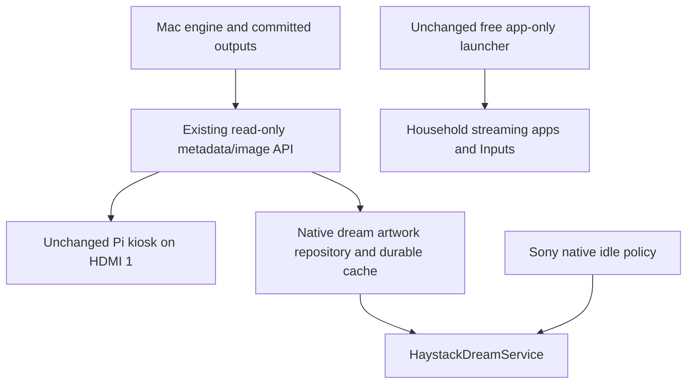
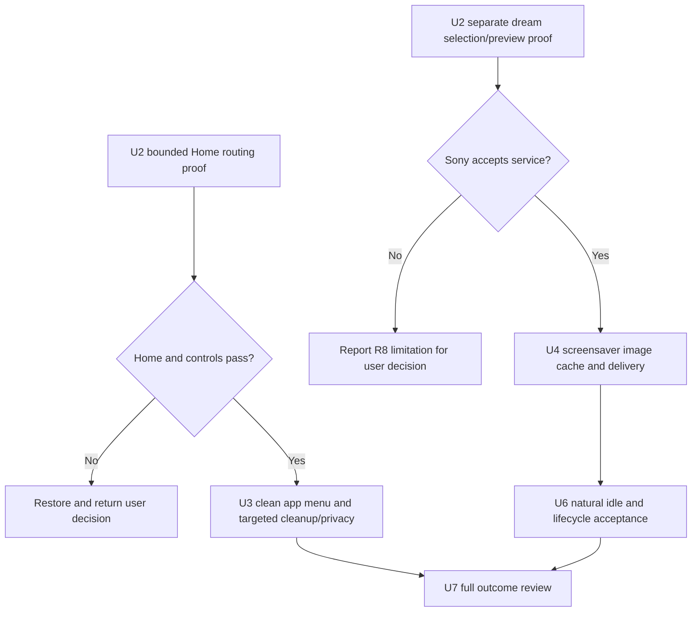

# Sony TV Performance and Haystack Integration - Plan

## Goal Capsule

- **Objective:** The household can navigate the Sony TV quickly, use an ad-free Home, reduce identifiable unnecessary tracking, and see current Haystack artwork during native idle time.
- **Means:** Use a free existing launcher, targeted cleanup/privacy configuration and a separate small native Haystack screensaver (KTD1–KTD7).
- **Authority:** The user made dynamic Home artwork optional and a separate fullscreen viewer unnecessary if the native screensaver succeeds. The launcher choice below is a revised recommendation, not permission to install or resume the earlier trial. The heartbeat remains paused.
- **Execution profile:** Implement one separately authorized unit at a time. Document-only planning does not authorize installations, live navigation, settings, cleanup or server deployment. Do not resume the earlier trial under its previous away-from-home authorization.
- **Stop conditions:** Restore the affected trial on lost Home, Inputs, controls, audio, keyboard, a used app or casting. Stop on unknown dependencies, paid feature requirements or unsuccessful recovery.
- **Ownership:** The implementer supplies measured evidence and exact recovery; the orchestrator reviews actual outcomes before reporting acceptance. Physical-only gaps remain explicit without making the owner operate a benchmark questionnaire.

---

## Product Contract

### Summary
Use an existing free ad-free app menu, measured Sony-specific cleanup and a separate Haystack native screensaver.
Home can have a plain/default or manually chosen static background; automatically changing Home art is deferred.
Keep Pi HDMI 1 operational. No custom launcher, wallpaper integration, standalone art viewer or new software purchase is required for this scope.

### Problem Frame

The Sony KD-55XE8096 has unwanted Home advertising and slow navigation, app launching and input selection.
Haystack currently lives behind a separate HDMI input.
The previous recommendation introduced Projectivy without establishing free custom-art support or reliable default-Home routing on this Sony; its live trial was restored and remains unaccepted.

### Key Decisions

- Performance and Home ad removal remain mandatory. Governs R1–R2.
- Preserve household apps, Chromecast and broadcast TV; SkyShowtime removal and conditional retirement of obsolete Max/HBO remain the named cleanup preferences. Governs R3–R6.
- Dynamic Haystack artwork behind the app menu is optional, and no separate fullscreen artwork mode is needed if the native screensaver succeeds (session-settled: user-directed — chosen over the three-surface design: artwork in the screensaver is enough). Governs R7–R11.
- Review manufacturer telemetry and launcher analytics explicitly, without promising elimination of every streaming/Google tracking path. Governs R12.

Product Contract preservation: R1–R6 and R10 remain; R7 is downgraded to a deferred enhancement, R8–R9 focus on the screensaver, and R11 excludes software fees for the remaining required features. R12 makes targeted privacy work explicit. The architectural preference remains proposed, not user-approved.

### Requirements

**Speed and advertising**

- R1. Improve everyday Home navigation and used-app launch responsiveness without material regression to Chromecast or input switching; measure comparable before/after actions rather than RAM alone.
- R2. Normal Home and return paths show no sponsored rows, including after restart and standby/wake; this excludes ads inside streaming apps.

**Preservation and recovery**

- R3. Preserve Netflix, Prime Video, YouTube, Spotify, Disney+, Apple TV, current Max/HBO, Movistar+, Filmin, RTVE, Atresplayer, Crunchyroll, VLC and Chromecast; leave other unconfirmed apps intact.
- R4. Remove SkyShowtime only in U3; retire obsolete HBO/Max packages only after the actual used app works and recovery is established. Unused voice search is a research candidate, not permission to disable shared dependencies.
- R5. Preserve broadcast, HDMI/Inputs, Pi HDMI 1, remote/Bluetooth, audio, keyboard, updates, Google dependencies and DRM. Broadcast removal requires significant measured benefit and a separate decision.
- R6. Every changed setting, package/component state and app installation has an exact restore action from a fresh initial-state ledger; no root, bootloader unlock or firmware flashing. Configuration snapshots are not full account/app-data backups.

**Artwork and cost**

- R7. A plain/default or manually chosen static Home background is sufficient; automatically changing Home artwork is deferred and no separate fullscreen viewer is required if the native screensaver succeeds. Keep Pi HDMI 1 available.
- R8. Offer a selectable native Haystack screensaver if Sony permits third-party DreamService selection and idle activation; report a failure as a limitation requiring a scope decision, not a completed screensaver. Do not interrupt playback, switch HDMI automatically or claim universal HDMI-idle activation or panel-off display.
- R9. While the Haystack screensaver is visible and the Mac is reachable, show a new successful Render within two minutes; retry failed downloads even if the Render ID is unchanged. Retain last-good bytes across network failures and restarts, with a harmless built-in background when no cache exists.
- R10. Keep generation, credentials, canonical artwork, D Continuity, schedules, retention and public-note contracts unchanged; TV clients only read presentation data and never trigger generation.
- R11. The ad-free Home and custom automatically refreshed Haystack screensaver must require no new paid licence, subscription or cloud-photo service; existing Haystack generation costs remain unchanged. Check documented feature costs before installation and verify any uncertain required controls during the bounded trial; do not purchase an unlock.

- R12. Reduce identifiable unnecessary manufacturer telemetry through available privacy settings and dependency-reviewed component changes, and disable the chosen launcher's usage/crash collection. Record the exact changes and remaining limitations; do not claim that all TV or streaming-app tracking is eliminated.

### Key Flows and Acceptance Examples

- F1 / AE1. Home opens an app-only menu; select Netflix, return Home and use Back exit paths. Clean Home persists through restart and standby/wake. Covers R1–R3, R5.
- F2 / AE2. Selecting HDMI 1 still shows the existing Pi. The native screensaver presents artwork without an app menu; no separate Haystack app-viewer button is required. Covers R5, R7.
- F3 / AE3. Render B appears on the server while the Haystack dream is visible; it displays B within two minutes. With the Mac asleep, A remains visible after process/device restart. Covers R8–R10.
- F4 / AE4. B downloads unsuccessfully or is purged between metadata and fetch; A stays visible and B is retried without waiting for C. Corrupt bytes never replace the cache. Covers R9.
- F5 / AE5. Sony enters the selected dream during a proven idle context; a remote action exits to usable controls. Streaming/casting playback and existing power policy are preserved. Covers R5, R8.
- F6 / AE6. A cleanup batch breaks a preserved feature; restore only that batch's exact original states and recheck before proceeding. Covers R3–R6.
- F7 / AE7. Disable the launcher's analytics/crash options and a positively identified telemetry batch; verify persisted settings and preserved household functions. Record this configuration evidence without calling it a traffic audit. Covers R5–R6, R12.

### Scope Boundaries

In scope: free existing-launcher configuration, reliable Home routing, targeted cleanup/privacy work, a screensaver-only read-only Haystack client, verification and exact recovery.
No FLauncher fork, custom HomeActivity/app catalog/focus implementation, wallpaper plugin/file injection, standalone ArtActivity, paid launcher feature, automatic HDMI switching, Pi-side generation, firmware work or unrelated Pi fix is proposed.
A network traffic audit and elimination of tracking within every used streaming/Google service are outside this work; preserve those services and their shared dependencies.
Stock-launcher disabling and new accessibility/remapping tools or grants are not authorized. If supported Home routing fails, restore and return a concrete user decision; stock Home is recovery, not an accepted ad-free result.
If Sony rejects the screensaver, report the limitation rather than automatically substituting a fullscreen app or changing the power policy.

---

## Planning Contract

### Verified Baseline and What Remains Unknown

The TV is Sony KD-55XE8096, Android 9/API 28, UI 1920×1080, about 1.9 GiB RAM; the original inventory contained 198 packages.
Stock Home is `com.google.android.tvlauncher/.MainActivity`; Ethernet ADB was `192.168.0.24:5555` during inspection.
The Mac serves the existing kiosk at `http://192.168.0.20:4321`; preserve its fixed private Wi-Fi identity/reservation. The extender no longer exists.
Read `docs/tv-integration.md` for exact state and prior evidence rather than copying absent animation settings to literal 1.0.

The Projectivy attempt proved ordinary installation, not accepted Home replacement: the preferred-Home setter returned success but HOME still resolved to stock. Injected settings input was unreliable; physical remote incompatibility was never established.
Projectivy was removed and 198 package IDs, all 287 captured settings entries and stock component states matched the fresh trial baseline. Actual casting playback failed in a fixture attempt without an earlier successful playback baseline; this is not proof of a regression.
No replacement Home, visible speed improvement, DRM/audio/cast acceptance or custom screensaver is established. Android activity timings and screenshots cannot establish all those outcomes.

### Alternatives and Source Evidence

Compare complete workflows: either launcher plus the same reviewed cleanup and the same independent screensaver. A launcher alone does not debloat Sony services or eliminate tracking.

| Approach | Fit for the reduced scope | Material tradeoff | Position |
|---|---|---|---|
| Free Projectivy + cleanup + Haystack dream | Existing ad-free menu; recent maintenance and advertised input shortcuts | Closed launcher source; required free controls and Sony routing still need proof | Preferred first candidate |
| Unchanged FLauncher + same cleanup + same dream | Free ad-free app grid and optional manual wallpaper; open GPLv3+ source | Inspected master last committed March 2023; Sony routing also unknown | Viable alternative |
| Stock Home + cleanup + dream | Preserves existing Home and may improve some background contention | Retains sponsored Home | Recovery or separately accepted reduced scope |
| Custom tv-vibehack launcher + cleanup + dream | Full control, MIT source | Own app grid, focus/catalog and updates without a required dynamic Home-art use case | Disproportionate; do not build |
| Original UAD alone | Package descriptions and reversible cleanup tooling | Neither Home replacement nor screensaver | Research aid, never blanket Sony-safe list |

**Why Projectivy is now the first candidate.** Once dynamic Home wallpaper is optional, its wallpaper Premium restriction does not prevent the required free app-only menu plus a separate screensaver. Its [4.72 release](https://github.com/spocky/miproja1/releases/tag/4.72) was published in October 2026 and its [official listing](https://play.google.com/store/apps/details?id=com.spocky.projengmenu) advertises input shortcuts, relevant to Pi/HDMI access. The listing does not prove every desired control is free: verify the exact app-row/default-background/input configuration without purchase. Its source repository is release/configuration/support material, not the complete launcher source.

**Why FLauncher remains viable.** It provides the smaller app-grid feature set without a paywall for manual wallpaper and can be inspected. The [official README](https://gitlab.com/flauncher/flauncher/-/raw/master/README.md) only reports Chromecast testing and its stock-disable/Home-remap examples are not Sony authorization. The inspected commit is `4930cd738a5ab32967953fe8b12790bc4b452872`, committed 3 March 2023; older source is a maintenance concern, not proof it is slow or broken. No exclusive speed advantage follows from native Java versus Flutter.

**Privacy needs configuration in either case.** [FLauncher settings source](https://gitlab.com/flauncher/flauncher/-/blob/4930cd738a5ab32967953fe8b12790bc4b452872/lib/providers/settings_service.dart) defaults release analytics/crash collection on and provides opt-outs. [Projectivy's developer policy](https://spocky.github.io/apps-privacy-policy/) describes Firebase usage/crash reporting and settings opt-outs. Its inspected APK has collection defaults false, which does not prove runtime network behavior. Disable and verify the actual options; neither launcher is assumed tracking-free.

**Engineering performance expectation.** An app-only Home should spend less work rendering and retrieving recommendations than the sponsored stock Home. Removing active unnecessary background services can reduce CPU/RAM contention and app reloads; removing dormant apps may only free storage. Both workflows share those mechanisms. Neither launcher directly accelerates Chromecast's network protocol or HDMI negotiation; measurements establish the gain and regressions, not whether a reasoned recommendation can be made.

**What changes the preference.** Prefer a separately approved FLauncher trial if required Projectivy controls need payment, physical settings interaction fails, its opt-outs cannot be set/persisted, or the user prioritizes auditability. The earlier injected-input failure did not establish physical-remote incompatibility. A shared Sony routing failure is not a reason to cycle through launchers automatically.

The independent Claude Opus 5.5 low-effort comparison concerns this reduced architecture, not the earlier custom-three-surface plan. Candidate preference remains conditional on Sony evidence; no replacement Home is accepted today.

### Key Technical Decisions

- KTD1. **Gate the two independent components before full configuration or screensaver development.** U2 records two separate results: the mandatory Home/routing/control proof, and native dream capability. Failure of dream selection must not prevent testing Home; it leaves R8 unresolved. Test ordinary app mode before default routing. The live compatibility experiment has a total 30-minute budget, excluding necessary restoration. Attempt only a supported chooser and, if new evidence justifies it for this component, one preferred-Home setter; skip known-ineffective repetition. On budget exhaustion restore and report. A separately proposed accessibility trial is not an automatic extension. Implements R1–R2, R5–R8, R11–R12.
- KTD2. **Preserve stock recovery.** Try supported Home selection with actual resolution/physical Home/Back evidence. A minimal dedicated Home accessibility interception may only be trialled if its precise behavior and permission are included in the next phase authorization; never silently grant access or remap volume. An interception with stock ad flashes or broken task routing fails R2. No stock disabling, root or launcher-manager installation is authorized. Implements R2, R5–R6.
- KTD3. **Keep cleanup and privacy independent and attributable.** Use one to three positively identified packages per batch with exact enabled-state recovery; remove SkyShowtime only with reinstall availability and app-data loss understood. Compare against the accepted clean menu, not a mixed launcher/art/cleanup change. Implements R1, R3–R6, R12.
- KTD4. **Reuse existing GET contracts.** `src/server/server.ts` already supplies allowlisted `/api/latest` metadata with a relative `imageUrl` and `/api/outputs/:id` image bytes; no wallpaper bridge or public filesystem route is initially needed. A fixture server supplies deterministic A/B/error cases without touching production outputs. Implements R9–R10.
- KTD5. **Use an unchanged launcher and own only the dream.** Configure the selected free launcher as app-only, with default/plain background, household apps, Settings and Inputs reachable. No launcher fork, billing/premium feature or custom app-grid code. The proposed `android-tv/` Java app contains HaystackDreamService, ArtworkRepository and app-private durable cache; any settings activity only configures the dream and is not a separate art viewer. No analytics SDK, browser engine or permanent foreground service. Implements R3, R5, R7–R12.
- KTD6. **Refresh only the visible screensaver.** Poll metadata every 60 seconds while dreaming, refresh on dream start and stop on detach; one shared in-flight fetch. Resolve image URLs against the configured Mac origin, reject foreign origins/redirects, configure Android cleartext HTTP only for the selected LAN host, and perform networking/decoding off the UI thread. Bound downloads to 32 MiB and 40 megapixels before sampled decoding to the 1080p UI; validate actual fixture/production formats against those caps. Persist candidate bytes and ID transactionally before publishing; cancellation, malformed bytes, 404 and decode failure keep the prior accepted image. Implements R1, R9–R10.
- KTD7. **Use the actual dream lifecycle.** Register a DreamService using the framework binding permission and selection metadata; never ask for broad secure-settings authority. Prove selection, natural idle entry, input exit and restart persistence separately from forced preview. Do not emulate system idle by overlaying other apps or forcing HDMI switches. Implements R5, R8.

### High-Level Technical Design

These diagrams describe proposed responsibilities, not shipped functionality.



```mermaid
sequenceDiagram
  participant Dream as Visible DreamService
  participant Cache as Artwork repository
  participant API as Mac API
  Dream->>Cache: Start; display cached image
  Cache->>API: GET latest then candidate image
  alt Valid decoded candidate
    Cache->>Cache: Atomic durable commit then accepted ID
    Cache-->>Dream: Display new Render
  else Network, purge, decode or write failure
    Cache-->>Dream: Keep last-good Render; retry next poll
  end
  Dream->>Cache: Stop; cancel polling and release resources
```



Home uses the existing launcher's visible D-pad focus and app rows; no new menu design is needed. The dream fits the entire image without unrequested cropping and exits through the native lifecycle. Preview, natural idle and active-playback protection are separate evidence boundaries.

### Dependencies and Execution Gates

U2 is a bounded implementable feasibility unit; U3, U4, U6 and U7 are conditional on the relevant independent results and separate authority. No one is claiming end-to-end Sony support now. If routing fails, restore and let the user choose whether to pursue a separately specified escalation, accept a reduced scope or stop; no fallback installation or architecture change happens automatically.
A failed dream capability does not invalidate an independently successful Home route, but R8 stays unresolved until the user accepts a limitation or another approach.
A failed default-Home route prevents an accepted ad-free Home: FLauncher and Projectivy do not automatically bypass the same Sony policy.
Android build tools, minSdk/API compatibility, production image caps and signing reproducibility are checked locally before any installation. Keep private signing keys outside Git and record a stable public certificate fingerprint for updates.
Do not start a platform rewrite or add another launcher after failure without presenting the new tradeoff.

### Effort and Maintenance Tradeoff

The custom-launcher estimate is superseded. This architecture has no launcher source build, app-grid implementation or three-surface artwork integration.
For planning, allow roughly 1–3 engineering hours for launcher provenance/preparation and a minimal dream fixture, then the KTD1 30-minute live experiment plus necessary restoration. The screensaver's bounded networking, durable cache, failure tests and lifecycle may need another 1–2 engineering days plus an available household verification window. These are rough allowances, not delivery promises; re-estimate after the fixture gate and toolchain check before authorizing full work.
The project still owns the small screensaver build, signing key and compatibility fixes. Launcher updates come from its developer rather than a maintained fork. There are no new paid display features or cloud-photo services. Cleanup effort depends on actual component dependencies.

### Sources and Existing Patterns

- [tv-vibehack source at 19f3c224fe68843cb2ff0df3157b81622bbe1266](https://github.com/Gathin23/tv-vibehack/tree/19f3c224fe68843cb2ff0df3157b81622bbe1266): MIT native Java sample considered but not adopted; do not execute its stock-disabling installer or approximate-state restore scripts.
- [FLauncher official source at 4930cd738a5ab32967953fe8b12790bc4b452872](https://gitlab.com/flauncher/flauncher/-/tree/4930cd738a5ab32967953fe8b12790bc4b452872): GPLv3+ Flutter launcher; candidate app as supplied, no GPL fork or source copying is proposed.
- [Cobanov guide](https://tv.cobanov.dev/): FLauncher and conservative non-root cleanup inspiration; its generic launcher-disable/cache/animation recipe is not a Sony runbook.
- [Original UAD](https://github.com/0x192/universal-android-debloater): package-description research only, never a blanket approved list.
- [Android TV app setup](https://developer.android.com/training/tv/get-started/create), [DreamService](https://developer.android.com/reference/android/service/dreams/DreamService), [network security configuration](https://developer.android.com/privacy-and-security/security-config): platform contracts, not device acceptance.
- `src/server/server.ts`: `toPresentationMetadata`, GET latest/image routes and loopback-only mutations; `src/storage/output-store.ts`: validated committed-image resolution and purge races.
- `public/kiosk.html`: 60-second polling precedent; do not copy its accepted-ID-before-image-load retry gap or assume durable offline caching exists there.
- `tests/server/server.test.ts`, `tests/storage/output-store.test.ts`: MIME, metadata allowlist, traversal, empty/latest and LAN permission tests.
- `docs/solutions/integration-issues/raspberry-pi-kiosk-hardcoded-mac-ip.md`, `CONCEPTS.md`: fixed LAN identity and Render/Kiosk vocabulary.

---

## Implementation Units

### U1. Reuse baseline and refresh exact recovery before a new trial

**Requirements:** R1, R3, R5–R6. **Files:** `docs/tv-integration.md`, `.claude/tasks/tasks.md`; private evidence under ignored `tv-local/`.
Use existing inventory and restoration work; do not repeat hours of exploration. At the next authorized live session record fresh settings presence/values, package/component enabled states, preferred Home, dream selection and installed trial apps. Re-establish current casting playback before attributing a later failure to the trial.
**Verification:** Record what is observed vs missing; do not claim that prior package/settings equality verifies audio, DRM or HDMI picture. No new feature tests apply to this documentation/evidence unit.

### U2. Prove free existing-launcher routing and independent dream capability

**Requirements:** R1–R3, R5–R8, R11–R12. **Decisions:** KTD1–KTD2, KTD5, KTD7. **Depends on:** fresh U1 recovery and explicit new trial authorization.
**Files:** `docs/tv-integration.md`, proposed `android-tv/` Gradle wrapper/build files, manifest, HaystackDreamService and fixture resources under `android-tv/app/src/main/`, `android-tv/README.md`. No HomeActivity, ArtActivity or app catalog is proposed.
Reuse verified package evidence; recheck actual release/signature before installation. Try the chosen launcher as an ordinary app, then the finite supported Home route with physical Home/Back and Settings/Inputs recovery. Do not repeat known-ineffective setter attempts without new evidence, silently grant accessibility or run generic disable/remap scripts. Keep minimal setup and the shared 30-minute experiment budget; record any omitted restart/wake checks as pending.
Separately build the smallest dream fixture compatible with API 28 and record Sony service selection/preview, even if Home fails. Neither proof substitutes for the other. Only after accepted Home proof configure app-only rows for all 13 used apps, all-app access, Settings/Inputs and launcher analytics/crash opt-outs. Verify free controls and persistence; no purchase.
**Scenarios/verification:** Physical Home/Back/D-pad/volume, Settings/Inputs and keyboard, restart/wake persistence, no sponsored Home returns, all 13 app shortcuts, actual free-tier limits, analytics settings persisted, exact restoration. Use device evidence rather than re-testing an unchanged third-party app with a new unit suite. Proposed fixture test: `android-tv/app/src/androidTest/java/dev/haystack/tv/DreamFixtureTest.java`; preview does not prove natural idle. Local debug/release builds, lint and signatures apply to the new dream fixture only.

### U3. Perform measured selective cleanup and privacy configuration

**Requirements:** R1, R3–R6, R12. **Decision:** KTD3. **Depends on:** accepted U2 Home or a separately approved cleanup-only route.
**Files:** `docs/tv-integration.md`, `.claude/tasks/tasks.md`; private per-change ledger.
Remove SkyShowtime with recovery prepared. Identify the actually used Max app, then retire legacy copies only if proven unused. Audit available Sony privacy settings and research telemetry, voice-search, Sony promotions and Samba components independently; do not equate a package description with a safe disable decision.
**Scenarios/verification:** Compare each small batch against U2; verify app access, casting, keyboard, controls and inputs before retaining it. Restore a failing batch to exact initial states. No invented unit test mirrors a package command; use device evidence. Do not retain speculative disabled services as a claimed performance improvement. Verify exact settings/component state and recovery for each privacy change; distinguish disabled reporting controls from a network-traffic audit, and preserve shared Google, casting, updates and streaming dependencies.

### U4. Prove existing API delivery and native cache

**Requirements:** R9–R11. **Decisions:** KTD4, KTD6. **Depends on:** U2 dream capability; independent local fixture work may be prepared without a live rollout.
**Proposed files:** `android-tv/app/src/main/java/dev/haystack/tv/ArtworkRepository.java`, `ArtworkCache.java`, Android network-security resource, native fixture tests; `android-tv/README.md`.
Use existing latest/image GET endpoints, not a new bridge. Persist candidate image bytes and associated accepted ID safely in app-private storage; retain last-good bytes for the screensaver alone with one in-flight fetch.
**Proposed tests:** `ArtworkRepositoryTest.java`, `ArtworkCacheTest.java` in the native unit-test directory; `ArtworkRecoveryTest.java` in the native instrumentation-test directory.
**Scenarios:** A→B success; B fails then succeeds with unchanged ID; empty latest; image purge404; offline cold start with/without cache; corrupt/truncated/oversized image; process death between writes; HTTP timeout; origin redirect rejection; duplicate starts, lifecycle cancellation and no polling after dream detach. Test PNG/JPEG/WebP from existing output patterns and sampled memory use.
**Verification:** Controlled local fixtures establish state transitions and request counts; no generation, paid Renders, live output-store changes or server restart. Only change server code later if a concrete contract gap is demonstrated and approved.

### U5. Retired from this scope

The user made dynamic Home wallpaper optional and a separate fullscreen viewer unnecessary if the screensaver succeeds. No wallpaper integration, launcher fork, ArtActivity or three-surface cache is to be implemented under this unit. Its identifier is retained for traceability; no implementation or tests apply.

### U6. Complete native idle artwork

**Requirements:** R5, R8–R11. **Decisions:** KTD6–KTD7. **Depends on:** U2 dream capability and U4; no dependency on launcher selection or retired U5.
**Proposed files:** HaystackDreamService and dream metadata in the native app, `DreamLifecycleTest.java` under native instrumentation tests, `docs/tv-integration.md`.
Use the proven selectable dream. Attach only during dreaming, release resources on stop, and retain existing timeout/power settings unless a specific change is authorized. A preview demonstrates rendering only; natural idle is a separate test.
**Scenarios/verification:** AE3–AE5; native idle at Home, exit on remote, restart persistence, Mac offline, process restart and no polling after dream stops. Verify active DRM and cast playback are not interrupted; test HDMI idle separately and report any OEM limitation. No standalone install success closes this unit.

### U7. Review the full outcome and hand off

**Requirements:** R1–R12. **Depends on:** accepted Home and dream results from U2, plus U3, U4 and U6, with any scope limitation explicitly resolved.
**Files:** `docs/tv-integration.md`, `.claude/tasks/tasks.md`, `android-tv/README.md`; update `AGENTS.md` only with verified operating instructions.
Review source, actual device state, signed build and evidence against the contract. Record install/update/recovery procedures, public signing certificate, offline behavior and Mac sleep dependency. Private keys, APKs, account images and raw dumps remain outside Git.
**Verification:** The matrix below must distinguish pass, fail and not verified. Remove abandoned trial code and stale recipes. Provide a household-readable result without requiring an owner stopwatch exercise.

---

## Verification Contract

| Area | Required evidence | Insufficient substitute |
|---|---|---|
| Cost and provenance | Feature-cost/provenance audit: official terms, APK/signature inspection and observed free required controls; custom dream source audited separately; closed-source launcher limitation recorded | Free initial installation |
| Home | Actual Home and repeated app exit paths, reboot and standby/wake; clean menu and preserved focus | Setter success or direct activity launch |
| Performance | Five comparable warm probes where practical, median and slowest; visible frame-ready/navigation evidence and post-restart separate | RAM percentage, animation reduction or Android WaitTime alone |
| Apps and Chromecast | All 13 app entries launch; representative DRM playback/audio and an actual cast start/play/stop before and after | Package present, Cast discovery or receiver connection |
| Hardware paths | Physical D-pad/Back/Home/volume, keyboard, broadcast, Inputs and Pi HDMI picture/audio | Screenshot of an input list |
| Artwork | A→B within two minutes, retry same failed ID, corrupt-image rejection, offline restart cache in the screensaver | A static wallpaper once |
| Idle | Actual selection, natural idle entry, exit, restart/wake persistence and playback protection | Forced preview or DreamService registration |
| Privacy | Identified telemetry/settings changes, launcher usage/crash opt-out persisted, shared functions preserved, limitations recorded | Claim that a launcher eliminates all tracking |
| Recovery | Fresh ledger and exact restoration of trial-owned key presence/values, package/component states, Home/dream/accessibility selection | Generic enable-everything command |

R1 compares identical interactions and separately measures Inputs chooser-open vs source-selection-to-stable-picture/audio. Record visible timings when automation can reliably observe the actual frames; otherwise label the evidence gap rather than asking the owner to run a benchmark.
A provisional engineering target for the proposed Home is warm return within one second and visible D-pad focus movement within 100 ms, measured over the same five probes; these are validation targets to test, not achieved or user-promised performance.
Report absolute and relative measurements for each used app; an unchanged already-fast app is acceptable, while a slower flow needs investigation. HDMI negotiation and streaming-service latency may remain outside launcher control.
Missing physical observations do not prevent independent local work, but do prevent claims of end-to-end household preservation or complete U7 acceptance.

For native code, provide a pinned Gradle wrapper and run `./gradlew :app:assembleDebug :app:assembleRelease :app:testDebugUnitTest :app:lint` from `android-tv/`; verify release signature and run `./gradlew :app:connectedDebugAndroidTest` on the appropriate test target. Provision signing outside Git. The wrapper/test modules are planned additions, not present commands today.
For any actual TypeScript/server change, run `npm run build` and `npm run test:run` plus focused server/storage tests; do not change server code merely to create work. This proposal changes documentation only and does not require application tests.

---

## Definition of Done

A phase is accepted only for the behavior its evidence establishes; unresolved items remain explicitly unchecked in `.claude/tasks/tasks.md`.
The full outcome requires R1–R12, including free custom screensaver imagery, clean persistent Home, targeted privacy work, cache/retry behavior, preserved everyday functions and a supported native idle route or a user-approved limitation.
Either accepted free launcher plus the accepted native Haystack screensaver meets the revised display scope; dynamic Home wallpaper and a standalone fullscreen mode are not acceptance gates. Stock Home or Pi alone remains an incomplete result unless the user explicitly accepts that limitation.
The TV retains usable stock recovery, no trial installs or unrelated service changes remain, and maintained source/build/signing instructions are reproducible.
The final report names remaining limitations without claiming a speed gain or physical behavior that was never observed.
