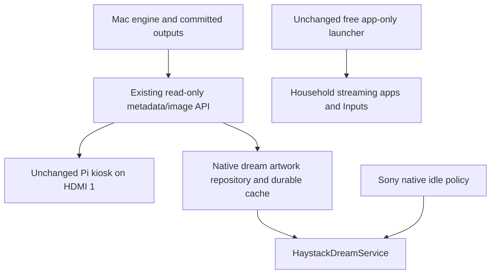
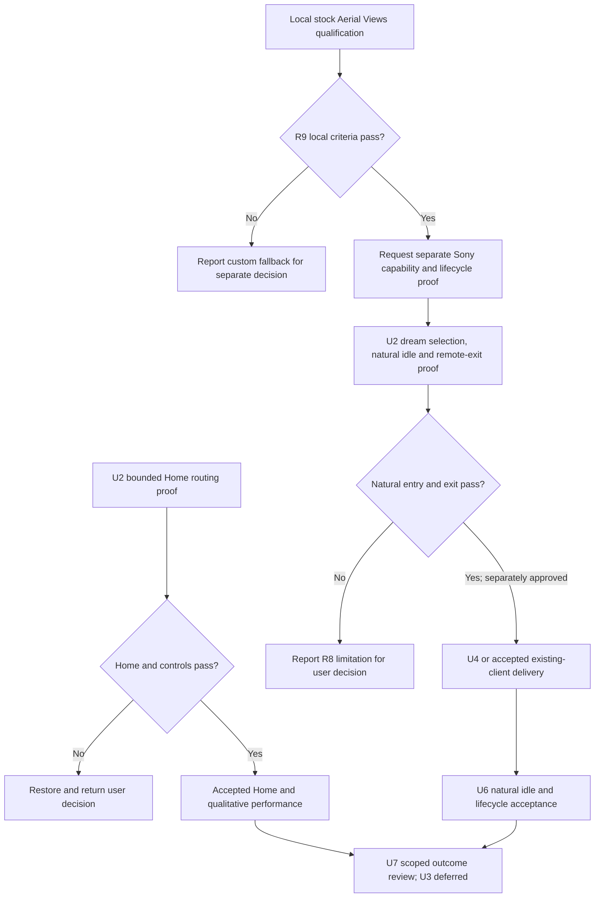

# Sony TV Performance and Haystack Integration - Plan

## Goal Capsule

- **Objective:** The household can navigate the Sony TV quickly, use an ad-free Home with launcher usage reporting disabled and crash reporting allowed, and see current Haystack artwork during native idle time. Manufacturer cleanup/privacy work is deferred by the user’s 2026-10-18 scope decision.
- **Means:** Preserve the accepted free Projectivy setup and qualify an existing native screensaver locally before considering the custom Haystack screensaver fallback (KTD1–KTD7). No U3 cleanup is required for the accepted scope.
- **Authority:** The user made dynamic Home artwork optional and a separate fullscreen viewer unnecessary if the native screensaver succeeds. The explicitly authorized manual Projectivy override/setup is accepted. On 2026-10-18 the user accepted current Home/HDMI responsiveness, deferred U3 and authorized bounded local Aerial qualification, which failed freshness. A subsequent separately authorized signed static Sony trial passed selection, preview, natural idle entry and physical exit. The user explicitly requested retaining Sony’s supported five-minute delay and checking Projectivy conflicts; no enabled conflict was found. Usage OFF/crash ON is the latest accepted preference. The subsequent explicit user decision authorizes U4 local artwork refresh/cache implementation and fixture testing only; TV upgrades, server deployment/restart and live acceptance remain separately gated. The heartbeat remains off.
- **Execution profile:** Implement one separately authorized unit at a time. Document-only planning does not authorize installations, live navigation, settings, cleanup or server deployment. Do not resume the earlier trial under its previous away-from-home authorization.
- **Stop conditions:** Restore the affected trial on lost Home, Inputs, controls, audio, keyboard, a used app or casting. Stop on unknown dependencies, paid feature requirements or unsuccessful recovery.
- **Ownership:** The implementer supplies measured evidence and exact recovery; the orchestrator reviews actual outcomes before reporting acceptance. Physical-only gaps remain explicit without making the owner operate a benchmark questionnaire.

---

## Product Contract

### Summary

Use the accepted free ad-free Projectivy app menu and a separate native Haystack screensaver. U3 Sony-specific cleanup is deferred, not completed.
Home can have a plain/default or manually chosen static background; automatically changing Home art is deferred.
Keep Pi HDMI 1 operational. No custom launcher, wallpaper integration, standalone art viewer or new software purchase is required for this scope.

### Problem Frame

The initial Sony KD-55XE8096 problem was unwanted Home advertising and slow navigation, app launching and input selection; the later Projectivy Home and qualitative performance outcome are now accepted.
Haystack currently lives behind a separate HDMI input.
The earlier recommendation introduced Projectivy without establishing free custom-art support or reliable Home routing; that initial trial was restored. The later explicitly authorized manual override and Home/setup are now accepted on the attributed human evidence below.

### Key Decisions

- Performance and Home ad removal remain mandatory; the Home/setup result and qualitative responsiveness are accepted from Andrés’s human report on 2026-10-18. No numerical speed gain is claimed. Governs R1–R2.
- Preserve household apps, Chromecast and broadcast TV. On 2026-10-18 Andrés considered U3 unnecessary after the successful Projectivy setup: defer SkyShowtime removal, obsolete Max/HBO retirement and all other cleanup without making them final acceptance blockers. Governs R3–R6.
- Dynamic Haystack artwork behind the app menu is optional, and no separate fullscreen artwork mode is needed if the native screensaver succeeds (session-settled: user-directed — chosen over the three-surface design: artwork in the screensaver is enough). Governs R7–R11.
- Launcher usage reporting must be OFF; crash reporting ON is explicitly accepted by the latest user direction and both associated switch states were verified. Earlier both-OFF human evidence and the intervening both-ON capture remain historical evidence in the runbook. Manufacturer telemetry reduction is deferred with U3; no reduction or traffic audit is claimed. Governs R12.

Product Contract preservation: R1–R3, R5–R6 and R10 remain; R4 cleanup is deferred, R7 is a deferred enhancement, R8–R9 focus on the screensaver, and R11 excludes software fees for the remaining required features. R12 now requires the latest accepted launcher reporting choices and honest limits; manufacturer changes are deferred. The existing-launcher/screensaver architecture and Projectivy-first planning preference are user-approved after comparison; live trials, permission grants and rollout remain separately authorized.

### Requirements

**Speed and advertising**

- R1. Improve everyday Home navigation and used-app launch responsiveness without material regression to Chromecast or input switching. Andrés accepted the qualitative outcome on 2026-10-18: Projectivy is “blisteringly fast”, exactly what he wanted, and he is happy with current performance (relayed via parent chat `01a14da5-d80c-7773-8251-f866efd4e1c2`). This satisfies the user’s responsiveness outcome without a numerical benchmark or quantified HDMI improvement; comparable measurements would be needed for any numerical claim.
- R2. Normal Home and return paths show no sponsored rows, including after restart and standby/wake; this excludes ads inside streaming apps.

**Preservation and recovery**

- R3. Preserve Netflix, Prime Video, YouTube, Spotify, Disney+, Apple TV, current Max/HBO, Movistar+, Filmin, RTVE, Atresplayer, Crunchyroll, VLC and Chromecast; leave other unconfirmed apps intact.
- R4. Deferred by the user on 2026-10-18: no SkyShowtime removal, obsolete HBO/Max retirement or voice-search changes are required or authorized. The earlier U3 proposal is retained for traceability; reopening it requires a new scope decision and exact recovery, not automatic execution.
- R5. Preserve broadcast, HDMI/Inputs, Pi HDMI 1, remote/Bluetooth, audio, keyboard, updates, Google dependencies and DRM. Broadcast removal requires significant measured benefit and a separate decision.
- R6. Every changed setting, package/component state and app installation has an exact restore action from a fresh initial-state ledger; no root, bootloader unlock or firmware flashing. Configuration snapshots are not full account/app-data backups.

**Artwork and cost**

- R7. A plain/default or manually chosen static Home background is sufficient; automatically changing Home artwork is deferred and no separate fullscreen viewer is required if the native screensaver succeeds. Keep Pi HDMI 1 available.
- R8. Offer a selectable native Haystack screensaver if Sony permits third-party DreamService selection and idle activation; report a failure as a limitation requiring a scope decision, not a completed screensaver. Do not interrupt playback, switch HDMI automatically or claim universal HDMI-idle activation or panel-off display.
- R9. While the Haystack screensaver is visible and the Mac is reachable, show a new successful Render within two minutes; retry failed downloads even if the Render ID is unchanged. Retain last-good bytes across network failures and restarts, with a harmless built-in background when no cache exists.
- R10. Keep generation, credentials, canonical artwork, D Continuity, schedules, retention and public-note contracts unchanged; TV clients only read presentation data and never trigger generation.
- R11. The ad-free Home and custom automatically refreshed Haystack screensaver must require no new paid licence, subscription or cloud-photo service; existing Haystack generation costs remain unchanged. Check documented feature costs before installation and verify any uncertain required controls during the bounded trial; do not purchase an unlock.

- R12. Keep the chosen launcher’s usage reporting OFF; crash reporting ON is explicitly accepted. The 15:52:07 associated switch readback matches that latest preference; the earlier both-OFF human report and later both-ON capture are retained chronologically in the runbook. Manufacturer telemetry/settings/component work is deferred with U3 by the user’s 2026-10-18 decision and is not a final acceptance blocker. Record that no manufacturer telemetry reduction or network audit was established; no claim that TV or streaming-app tracking is eliminated.

### Key Flows and Acceptance Examples

- F1 / AE1. Home opens an app-only menu; select Netflix, return Home and use Back exit paths. Clean Home persists through restart and standby/wake. Covers R1–R3, R5.
- F2 / AE2. Selecting HDMI 1 still shows the existing Pi. The native screensaver presents artwork without an app menu; no separate Haystack app-viewer button is required. Covers R5, R7.
- F3 / AE3. Render B appears on the server while the Haystack dream is visible; it displays B within two minutes. With the Mac asleep, A remains visible after process/device restart. Covers R8–R10.
- F4 / AE4. B downloads unsuccessfully or is purged between metadata and fetch; A stays visible and B is retried without waiting for C. Corrupt bytes never replace the cache. Covers R9.
- F5 / AE5. Sony enters the selected dream during a proven idle context; a remote action exits to usable controls. Streaming/casting playback and separate sleep policy are preserved; the user explicitly chose the supported five-minute screensaver delay as the retained configuration. Covers R5, R8.
- F6 / AE6. Deferred with U3: if cleanup is separately reopened and a batch breaks a preserved feature, restore only that batch’s exact original states and recheck. Covers R3–R6; not a current acceptance gate.
- F7 / AE7. Preserve the latest accepted launcher usage OFF/crash ON configuration and household functions. A manufacturer telemetry batch is deferred with U3, not required for acceptance. Configuration evidence is not a traffic audit. Covers R5–R6, R12.

### Scope Boundaries

In scope: the accepted free existing-launcher configuration and Home routing, a bounded local stock Aerial Views qualification, and subsequently separately gated screensaver-only read-only delivery, verification and exact recovery. U3 cleanup/manufacturer privacy changes are deferred and excluded from required acceptance.
No FLauncher fork, custom HomeActivity/app catalog/focus implementation, wallpaper plugin/file injection, standalone ArtActivity, paid launcher feature, automatic HDMI switching, Pi-side generation, firmware work or unrelated Pi fix is proposed.
A network traffic audit and elimination of tracking within every used streaming/Google service are outside this work; preserve those services and their shared dependencies.
Preserve the accepted, explicitly authorized manual Projectivy accessibility override. Stock-launcher disabling and additional accessibility/remapping tools or grants are not authorized. If supported Home routing fails, restore and return a concrete user decision; stock Home is recovery, not an accepted ad-free result.
If Sony rejects the screensaver, report the limitation rather than automatically substituting a fullscreen app or changing the power policy.

---

## Planning Contract

### Verified Baseline and What Remains Unknown

The TV is Sony KD-55XE8096, Android 9/API 28, UI 1920×1080, about 1.9 GiB RAM; the original inventory contained 198 packages.
Stock Home is `com.google.android.tvlauncher/.MainActivity`; Ethernet ADB was `192.168.0.24:5555` during inspection.
The Mac serves the existing kiosk at `http://192.168.0.20:4321`; preserve its fixed private Wi-Fi identity/reservation. The extender no longer exists.
Read `docs/tv-integration.md` for exact state and prior evidence rather than copying absent animation settings to literal 1.0.

Historical initial Projectivy trial (superseded by the later accepted manual setup) proved ordinary installation, not accepted Home replacement: the preferred-Home setter returned success but HOME still resolved to stock. Injected settings input was unreliable; physical remote incompatibility was never established.
Projectivy was removed and 198 package IDs, all 287 captured settings entries and stock component states matched the fresh trial baseline. Actual casting playback failed in a fixture attempt without an earlier successful playback baseline; this is not proof of a regression.
At that historical stopping point no replacement Home or household acceptance was established. Later on 2026-10-18, Andrés confirmed clean Settings→Home and Netflix→Back/Exit routes, all 13 apps, Settings/Inputs, hidden unwanted rows, usage/crash OFF, restart/wake persistence, controls, app access, Chromecast and Pi HDMI 1. He then accepted Projectivy as “blisteringly fast”, exactly what he wanted, and said U3 was unnecessary (source: parent chat `01a14da5-d80c-7773-8251-f866efd4e1c2`). These are human-reported passes, not numerical benchmarks, measured HDMI improvement, manufacturer telemetry reduction or executed exact recovery. The later separately authorized static Sony trial passed normal selection, preview, natural idle entry and physical remote exit. U2 Home and minimal Sony capability are accepted; full U4/U6 delivery, lifecycle and playback protection remain pending. Andrés also directly confirmed HDMI selection is now fast with Projectivy; no numerical gain is claimed.

### Alternatives and Source Evidence

Historical alternatives compared complete workflows with the same proposed cleanup and independent screensaver. Cleanup was subsequently deferred by the user on 2026-10-18; those table rows preserve the earlier rationale, not current authority. A launcher alone does not debloat Sony services or eliminate tracking.

| Approach | Fit for the reduced scope | Material tradeoff | Position |
|---|---|---|---|
| Free Projectivy + cleanup + Haystack dream | Existing ad-free menu; recent maintenance and advertised input shortcuts | Closed launcher source; required free controls and Sony routing still need proof | Preferred first candidate |
| Unchanged FLauncher + same cleanup + same dream | Free ad-free app grid and optional manual wallpaper; open GPLv3+ source | Inspected master last committed March 2023; Sony routing also unknown | Viable alternative |
| Stock Home + cleanup + dream | Preserves existing Home and may improve some background contention | Retains sponsored Home | Recovery or separately accepted reduced scope |
| Custom tv-vibehack launcher + cleanup + dream | Full control, MIT source | Own app grid, focus/catalog and updates without a required dynamic Home-art use case | Disproportionate; do not build |
| Original UAD alone | Package descriptions and reversible cleanup tooling | Neither Home replacement nor screensaver | Research aid, never blanket Sony-safe list |

**Why Projectivy is now the first candidate.** Once dynamic Home wallpaper is optional, its wallpaper Premium restriction does not prevent the required free app-only menu plus a separate screensaver. Its [4.72 release](https://github.com/spocky/miproja1/releases/tag/4.72) was published in October 2026 and its [official listing](https://play.google.com/store/apps/details?id=com.spocky.projengmenu) advertises input shortcuts, relevant to Pi/HDMI access. The listing does not prove every desired control is free: verify the exact app-row/default-background/input configuration without purchase. Its source repository is release/configuration/support material, not the complete launcher source.

**Why FLauncher remains viable.** It provides the smaller app-grid feature set without a paywall for manual wallpaper and can be inspected. The [official README](https://gitlab.com/flauncher/flauncher/-/raw/master/README.md) only reports Chromecast testing and its stock-disable/Home-remap examples are not Sony authorization. The inspected commit is `4930cd738a5ab32967953fe8b12790bc4b452872`, committed 3 March 2023; older source is a maintenance concern, not proof it is slow or broken. No exclusive speed advantage follows from native Java versus Flutter.

**Privacy needs configuration in either case.** [FLauncher settings source](https://gitlab.com/flauncher/flauncher/-/blob/4930cd738a5ab32967953fe8b12790bc4b452872/lib/providers/settings_service.dart) defaults release analytics/crash collection on and provides opt-outs. [Projectivy's developer policy](https://spocky.github.io/apps-privacy-policy/) describes Firebase usage/crash reporting and settings opt-outs. Its inspected APK has collection defaults false, which does not prove runtime network behavior. Verify actual options against the latest user preference (usage OFF, crash ON accepted); neither launcher is assumed tracking-free.

**Engineering performance expectation.** An app-only Home should spend less work rendering and retrieving recommendations than the sponsored stock Home. Removing active unnecessary background services can reduce CPU/RAM contention and app reloads; removing dormant apps may only free storage. Both workflows share those mechanisms. Neither launcher directly accelerates Chromecast's network protocol or HDMI negotiation; measurements establish the gain and regressions, not whether a reasoned recommendation can be made.

**What changes the preference.** Prefer a separately approved FLauncher trial if required Projectivy controls need payment, physical settings interaction fails, its opt-outs cannot be set/persisted, or the user prioritizes auditability. The earlier injected-input failure did not establish physical-remote incompatibility. A shared Sony routing failure is not a reason to cycle through launchers automatically.

The independent Claude Opus 5.5 low-effort comparison reached the Projectivy-free-first preference after two rounds for this reduced architecture, not the earlier custom-three-surface plan. Its external check was unavailable; the host verified the linked primary sources and the peer inspected local device evidence. That comparison predates the later accepted manual Home/setup evidence recorded above; no additional launcher trial is required.

### Key Technical Decisions

- KTD1. **Gate the two independent components before full configuration or screensaver development.** U2 records two separate results: the mandatory Home/routing/control proof, and native dream capability through natural idle entry and remote exit with the minimal fixture. Failure of dream selection must not prevent testing Home; it leaves R8 unresolved. Test ordinary app mode before default routing. The live compatibility experiment has a total 30-minute budget, excluding necessary restoration. Attempt only a supported chooser and, if new evidence justifies it for this component, one preferred-Home setter; skip known-ineffective repetition. On budget exhaustion restore and report. A separately proposed accessibility trial is not an automatic extension. Implements R1–R2, R5–R8, R11–R12.
- KTD2. **Preserve stock recovery.** Try supported Home selection with actual resolution/physical Home/Back evidence. A minimal dedicated Home accessibility interception may only be trialled if its precise behavior and permission are included in the next phase authorization; never silently grant access or remap volume. An interception with stock ad flashes or broken task routing fails R2. No stock disabling, root or launcher-manager installation is authorized. Implements R2, R5–R6.
- KTD3. **Defer cleanup by the user’s scope decision.** On 2026-10-18 Andrés accepted current Projectivy responsiveness and considered U3 unnecessary. Do not remove packages or change manufacturer privacy/voice components, and do not require U3 for U7. Historical rationale, if separately reopened: small identified batches with exact recovery would distinguish cleanup effects from the accepted launcher. Implements the revised R1, R3–R6, R12.
- KTD4. **Reuse existing GET contracts.** `src/server/server.ts` already supplies allowlisted `/api/latest` metadata with a relative `imageUrl` and `/api/outputs/:id` image bytes; no wallpaper bridge or public filesystem route is initially needed. A fixture server supplies deterministic A/B/error cases without touching production outputs. Implements R9–R10.
- KTD5. **Preserve Projectivy free and qualify an existing dream before custom work** (session-settled: user-approved — chosen over FLauncher-first and a custom launcher: recent maintenance favours Projectivy when dynamic Home wallpaper is optional; FLauncher retains an auditability advantage). Configure the selected free launcher as app-only, with default/plain background, household apps, Settings and Inputs reachable. No launcher fork, billing/premium feature or custom app-grid code. The Sony still runs version 1’s accepted signed static DreamService fixture. The separately authorized version 2 local implementation adds ArtworkRepository and an app-private durable cache; it has not been installed on the Sony. Any settings activity only configures the dream and is not a separate art viewer. No analytics SDK, browser engine or permanent foreground service. Implements R3, R5, R7–R12.
- KTD6. **Refresh only the visible screensaver.** Poll metadata every 60 seconds while dreaming, refresh on dream start and stop on detach; one shared in-flight fetch. Resolve image URLs against the configured Mac origin, reject foreign origins/redirects, configure Android cleartext HTTP only for the selected LAN host, and perform networking/decoding off the UI thread. Bound downloads to 32 MiB and 40 megapixels before sampled decoding to the 1080p UI; validate actual fixture/production formats against those caps. Persist candidate bytes and ID transactionally before publishing; cancellation, malformed bytes, 404 and decode failure keep the prior accepted image. Implements R1, R9–R10.
- KTD7. **Use the actual dream lifecycle.** Register a DreamService using the framework binding permission and selection metadata; never ask for broad secure-settings authority. Prove selection, natural idle entry, input exit and restart persistence separately from forced preview. Do not emulate system idle by overlaying other apps or forcing HDMI switches. Implements R5, R8.

### High-Level Technical Design

These diagrams describe the locally implemented custom fallback responsibilities. The stock Aerial Views qualification failed, the Sony static capability passed, and the user separately approved local U4 implementation. Version 2 networking/cache is not deployed to the Sony.



```mermaid
sequenceDiagram
  participant Dream as Visible DreamService
  participant Cache as Artwork repository
  participant API as Mac API
  Dream->>Cache: Start; display cached image
  Cache->>API: GET latest then candidate image
  alt Valid decoded candidate
    Cache->>Cache: Atomic durable commit then accepted ID
    Cache-->>Dream: Display new Render
  else Network, purge, decode or write failure
    Cache-->>Dream: Keep last-good Render; retry next poll
  end
  Dream->>Cache: Stop; cancel polling and release resources
```



Home uses the existing launcher's visible D-pad focus and app rows; no new menu design is needed. The dream fits the entire image without unrequested cropping and exits through the native lifecycle. Preview, natural idle and active-playback protection are separate evidence boundaries.

### Dependencies and Execution Gates

U2 has accepted Home/setup and independent minimal static Sony dream branches. Normal selection, preview, natural idle entry and physical exit passed; this does not establish full artwork delivery, cache, restart/wake or playback protection. U3 is deferred by user scope decision, not a dependency of U7. U4, U6 and U7 remain conditional on their relevant results and separate authority. No one is claiming end-to-end Sony support now. If routing fails, restore and let the user choose whether to pursue a separately specified escalation, accept a reduced scope or stop; no fallback installation or architecture change happens automatically.
A failed dream capability does not invalidate an independently successful Home route, but R8 stays unresolved until the user accepts a limitation or another approach.
A failed default-Home route prevents an accepted ad-free Home: FLauncher and Projectivy do not automatically bypass the same Sony policy.
Android build tools, minSdk/API compatibility, production image caps and signing reproducibility are checked locally before any installation. Keep private signing keys outside Git and record a stable public certificate fingerprint for updates.
Do not start a platform rewrite or add another launcher after failure without presenting the new tradeoff.

### Phase Boundaries and Next Handoff

| Unit | Independently reviewable result | Live-system boundary |
|---|---|---|
| U1 | Reuse recorded baseline and prepare exact recovery; refresh actual state before mutation | Fresh TV inspection only in the authorized session |
| U2 preparation | Rechecked launcher provenance/signature, free-feature checklist, precise routing proposal, signed minimal dream fixture and local checks | No ADB connection, TV install/configuration or live screen capture |
| U2 live proof | Accepted Home/control plus static Sony selection, preview, natural idle and physical exit; no full artwork lifecycle claim | Separate live authorization executed, including retained five-minute delay; no new accessibility grant or stock disable |
| U3 | Deferred by the user on 2026-10-18; historical cleanup proposal retained | No cleanup/privacy/voice changes authorized or required for acceptance |
| Local Aerial qualification | Complete: stock 1.8.5 disqualified by local ≤120-second freshness failure; retry/offline cases stopped, not failed | Isolated fixture server/disposable verified emulator only; no Sony or production changes |
| U4 | Explicitly authorized local screensaver delivery/cache implementation and fixture testing after qualification and Sony capability proof | No TV upgrade, production output change, server deployment or restart |
| U6 | Native idle art, refresh, exit and playback protection established | Authorized TV session; preview is not natural-idle acceptance |
| U7 | Evidence reconciled against R1–R12, remaining limits and recovery documented | No completion claim for missing physical evidence |

The bounded local stock Aerial Views 1.8.5 qualification is complete and the stock release is **disqualified for R9 freshness**: old unique-URL and fixed-alias images persisted for 127.4 seconds during one uninterrupted dream, with zero app requests after publication. Source and runtime evidence, exact provenance and the early stop are recorded in the [qualification report](../aerial-views-qualification.md). Same-ID/URL error retry and durable offline restart were **not tested**, not failed; no exhaustive follow-up or patch/fork was needed after the decisive failure. The disposable emulator and loopback fixture were stopped. No Sony or production system was changed by that local qualification.

The separately authorized **signed static Sony DreamService capability gate is accepted**. Normal Sony selection, owner-photo preview and physical preview exit passed; natural entry was observed after the 15:59:07 no-dream checkpoint and by 16:00:10 (`Dreaming`, actual Haystack service), with the owner reporting it visible. The owner then confirmed physical exit from that natural session: “Yes, returns cleanly to Projectivy”. Exact onset was not measured. See the [current Sony evidence](../tv-integration.md#accepted-sony-static-dream-capability--18-october-2026).

The user explicitly requested keeping Sony’s supported **Salvapantallas → Cuándo se activa → 5 minutos**: `system.screen_off_timeout=300000`, original `3600000` retained only for recovery history. Separate `secure.sleep_timeout=-1` remains unchanged. Projectivy’s prevent-system-screensaver, simulated-activity and internal-idle-detection switches were OFF; no enabled conflict or preference change was found. Usage OFF/crash ON matches the latest accepted preference. Preserve Projectivy, the installed selected fixture and five-minute delay; do not automatically restore an hour.

Aerial Views is not adopted or authorized for Sony installation. After accepting the static capability, the user explicitly authorized the custom U4 fallback for local artwork refresh/cache implementation and fixture testing. This does not authorize a TV upgrade, server deployment/restart or production changes. U4 is locally implemented and verified; U6/U7 remain pending. U3 remains deferred and does not block final acceptance. No server restart, production output, paid generation, Pi/network change, package cleanup or heartbeat activation is authorized.

### Effort and Maintenance Tradeoff

The custom-launcher estimate is superseded. This architecture has no launcher source build, app-grid implementation or three-surface artwork integration.
For planning, allow roughly 1–3 engineering hours for launcher provenance/preparation and a minimal dream fixture, then the KTD1 30-minute live experiment plus necessary restoration. The screensaver's bounded networking, durable cache, failure tests and lifecycle may need another 1–2 engineering days plus an available household verification window. These are rough allowances, not delivery promises; re-estimate after the fixture gate and toolchain check before authorizing full work.
The project owns the static fixture build and signing key; full custom-client maintenance remains contingent on the local existing-client qualification and a separately approved fallback. Launcher updates come from its developer rather than a maintained fork. There are no new paid display features or cloud-photo services. Cleanup effort depends on actual component dependencies.

### Sources and Existing Patterns

- [tv-vibehack source at 19f3c224fe68843cb2ff0df3157b81622bbe1266](https://github.com/Gathin23/tv-vibehack/tree/19f3c224fe68843cb2ff0df3157b81622bbe1266): MIT native Java sample considered but not adopted; do not execute its stock-disabling installer or approximate-state restore scripts.
- [FLauncher official source at 4930cd738a5ab32967953fe8b12790bc4b452872](https://gitlab.com/flauncher/flauncher/-/tree/4930cd738a5ab32967953fe8b12790bc4b452872): GPLv3+ Flutter launcher; candidate app as supplied, no GPL fork or source copying is proposed.
- [Cobanov guide](https://tv.cobanov.dev/): FLauncher and conservative non-root cleanup inspiration; its generic launcher-disable/cache/animation recipe is not a Sony runbook.
- [Original UAD](https://github.com/0x192/universal-android-debloater): package-description research only, never a blanket approved list.
- [Android TV app setup](https://developer.android.com/training/tv/get-started/create), [DreamService](https://developer.android.com/reference/android/service/dreams/DreamService), [network security configuration](https://developer.android.com/privacy-and-security/security-config): platform contracts, not device acceptance.
- `src/server/server.ts`: `toPresentationMetadata`, GET latest/image routes and loopback-only mutations; `src/storage/output-store.ts`: validated committed-image resolution and purge races.
- `public/kiosk.html`: 60-second polling precedent; do not copy its accepted-ID-before-image-load retry gap or assume durable offline caching exists there.
- `tests/server/server.test.ts`, `tests/storage/output-store.test.ts`: MIME, metadata allowlist, traversal, empty/latest and LAN permission tests.
- `docs/solutions/integration-issues/raspberry-pi-kiosk-hardcoded-mac-ip.md`, `CONCEPTS.md`: fixed LAN identity and Render/Kiosk vocabulary.

---

## Implementation Units

### U1. Reuse baseline and refresh exact recovery before a new trial

**Requirements:** R1, R3, R5–R6. **Files:** `docs/tv-integration.md`, `.claude/tasks/tasks.md`; private evidence under ignored `tv-local/`.
Use existing inventory and restoration work; do not repeat hours of exploration. At the next authorized live session record fresh settings presence/values, package/component enabled states, preferred Home, dream selection and installed trial apps. Re-establish current casting playback before attributing a later failure to the trial.
**Verification:** Record what is observed vs missing; do not claim that prior package/settings equality verifies audio, DRM or HDMI picture. No new feature tests apply to this documentation/evidence unit.

### U2. Prove free existing-launcher routing and independent dream capability

**Requirements:** R1–R3, R5–R8, R11–R12. **Decisions:** KTD1–KTD2, KTD5, KTD7. **Depends on:** local preparation reuses recorded U1 evidence with no TV connection; live proof requires fresh U1 recovery and explicit new trial authorization. Home/setup and the independent minimal static Sony dream capability are accepted on the evidence above. This does not complete U4/U6/U7.
**Files:** `docs/tv-integration.md`, `android-tv/settings.gradle`, `android-tv/build.gradle`, `android-tv/gradle/wrapper/gradle-wrapper.properties`, `android-tv/app/build.gradle`, `android-tv/app/src/main/AndroidManifest.xml`, `android-tv/app/src/main/java/dev/haystack/tv/HaystackDreamService.java`, dream metadata and fixture resources, and `android-tv/README.md` (the static fixture files now exist; network/cache files remain proposed). No HomeActivity, ArtActivity or app catalog is proposed.
**Preparation:** Reuse verified package evidence; recheck the candidate release/signature and record the exact free app-only/default-background/Inputs/analytics controls to verify. Identify a justified routing attempt before requesting live time; the old successful-looking setter is not a new hypothesis. Build/sign the minimal dream fixture locally with no network client yet. Report local build/lint/emulator results and a concrete live test/recovery sheet. This preparation has no TV connection or mutation.
**Live proof, separately authorized:** Recheck fresh state before installation. Try the chosen launcher as an ordinary app, then the finite supported Home route with physical Home/Back and Settings/Inputs recovery. Do not repeat known-ineffective setter attempts without new evidence, silently grant accessibility or run generic disable/remap scripts. Keep minimal setup and the shared 30-minute experiment budget; record any omitted restart/wake checks as pending.
Install the locally prepared minimal dream fixture only within the authorized live proof and record Sony service selection/preview independently, even if Home fails. Establish natural idle entry and remote exit with the fixture before full U4 work; preview alone leaves that gate pending. Use the separately authorized observation window when the existing timer cannot fit KTD1's budget. Neither branch substitutes for the other. Only after accepted Home proof configure app-only rows for all 13 used apps, all-app access, Settings/Inputs and launcher reporting choices (currently usage OFF/crash ON accepted). Verify free controls and persistence; no purchase.
**Scenarios/verification:** Physical Home/Back/D-pad/volume, Settings/Inputs and keyboard, restart/wake persistence, no sponsored Home returns, all 13 app shortcuts, actual free-tier limits, analytics settings persisted, exact restoration. Use device evidence rather than re-testing an unchanged third-party app with a new unit suite. Proposed fixture test: `android-tv/app/src/androidTest/java/dev/haystack/tv/DreamFixtureTest.java`; preview does not prove natural idle; natural entry/exit is the pre-U4 capability gate, and full refresh/offline/playback protection stays in U6. Local debug/release builds, lint and signatures apply to the new dream fixture only.

### U3. Deferred selective cleanup and manufacturer privacy configuration

**Status:** Deferred by Andrés on 2026-10-18 after accepting Projectivy’s “blisteringly fast” responsiveness; not completed and not required for U7. No package removal, privacy or voice changes are authorized.
**Historical proposal only:** R1, R3–R6, R12; KTD3. Any reopening needs a new explicit scope decision.
**Files:** `docs/tv-integration.md`, `.claude/tasks/tasks.md`; private per-change ledger.
The earlier proposal was to remove SkyShowtime with recovery prepared, identify the actually used Max app before retiring legacy copies, and research Sony privacy/telemetry/voice/promotions/Samba dependencies. This rationale remains historical, not an instruction to perform it now; package descriptions alone never established safe changes.
**Historical verification if separately reopened:** Compare each small batch against U2; verify app access, casting, keyboard, controls and inputs before retaining it. Restore a failing batch to exact initial states. No invented unit test mirrors a package command; use device evidence. Do not retain speculative disabled services as a claimed performance improvement. Verify exact settings/component state and recovery for each privacy change; distinguish disabled reporting controls from a network-traffic audit, and preserve shared Google, casting, updates and streaming dependencies.

### U4. Prove existing API delivery and native cache

**Requirements:** R9–R11. **Decisions:** KTD4, KTD6. **Status:** Locally implemented and verified. No live upgrade authorized. **Depends on:** completed local existing-client qualification and accepted U2 Sony natural-idle entry/physical exit. No TV upgrade, server deployment/restart or production-output change is authorized by this unit.
**Implemented files:** `android-tv/app/src/main/java/dev/haystack/tv/ArtworkRepository.java`, `ArtworkCache.java`, bounded decoder, cancellation and dream-lifecycle controller; generated host-specific Android network-security policy; native tests; `android-tv/README.md`.
Use existing latest/image GET endpoints, not a new bridge. Persist candidate image bytes and associated accepted ID safely in app-private storage; retain last-good bytes for the screensaver alone with one in-flight fetch.
**Proposed tests:** `android-tv/app/src/test/java/dev/haystack/tv/ArtworkRepositoryTest.java`, `android-tv/app/src/test/java/dev/haystack/tv/ArtworkCacheTest.java`, and `android-tv/app/src/androidTest/java/dev/haystack/tv/ArtworkRecoveryTest.java`.
**Scenarios:** A→B success; B fails then succeeds with unchanged ID; empty latest; image purge404; offline cold start with/without cache; corrupt/truncated/oversized image; process death between writes; HTTP timeout; origin redirect rejection; duplicate starts, lifecycle cancellation and no polling after dream detach. Test PNG/JPEG/WebP from existing output patterns and sampled memory use.
**Verification:** Controlled local fixtures establish state transitions and request counts; no generation, paid Renders, live output-store changes or server restart. Only change server code later if a concrete contract gap is demonstrated and approved.

### U5. Retired from this scope

The user made dynamic Home wallpaper optional and a separate fullscreen viewer unnecessary if the screensaver succeeds. No wallpaper integration, launcher fork, ArtActivity or three-surface cache is to be implemented under this unit. Its identifier is retained for traceability; no implementation or tests apply.

### U6. Complete native idle artwork

**Requirements:** R5, R8–R11. **Decisions:** KTD6–KTD7. **Depends on:** U2 dream capability and accepted delivery/cache through U4 or a separately approved existing-client route; no dependency on U3, launcher selection or retired U5.
**Proposed files:** `android-tv/app/src/main/java/dev/haystack/tv/HaystackDreamService.java`, `android-tv/app/src/main/res/xml/dream_info.xml`, `android-tv/app/src/androidTest/java/dev/haystack/tv/DreamLifecycleTest.java`, and `docs/tv-integration.md`.
Use the proven selectable dream. Attach only during dreaming, release resources on stop, and retain existing timeout/power settings unless a specific change is authorized. A preview demonstrates rendering only; natural idle is a separate test.
**Scenarios/verification:** AE3–AE5; native idle at Home, exit on remote, restart persistence, Mac offline, process restart and no polling after dream stops. Verify active DRM and cast playback are not interrupted; test HDMI idle separately and report any OEM limitation. No standalone install success closes this unit.

U6 progress on 18 October: the separately authorized version-2 Sony update reached current production artwork through natural idle and physical remote exit passed. Image quality failed: 2048×1136 source pixels were undersampled to 1024×568. Subsequent lifecycle/playback tests are paused for the reviewed version-3 detail correction. Native API-28/35 regression and actual-source probes verify a local 1920×1065 fitted result; these do not establish corrected Sony acceptance. No isolated-origin APK has been installed. See the current U6 quality record in `docs/tv-integration.md`.

### U7. Review the full outcome and hand off

**Requirements:** R1–R12 as revised by the 2026-10-18 user scope decision. **Depends on:** accepted Home and dream results from U2, plus the separately accepted screensaver delivery/lifecycle results from U4/U6 or an approved existing-client route. U3 is explicitly deferred and is not a dependency.
**Files:** `docs/tv-integration.md`, `.claude/tasks/tasks.md`, `android-tv/README.md`; update `AGENTS.md` only with verified operating instructions.
Review source, actual device state, signed build and evidence against the contract. Record install/update/recovery procedures, public signing certificate, offline behavior and Mac sleep dependency. Private keys, APKs, account images and raw dumps remain outside Git.
**Verification:** The matrix below must distinguish pass, fail and not verified. Remove abandoned trial code and stale recipes. Provide a household-readable result without requiring an owner stopwatch exercise.

---

## Verification Contract

| Area | Required evidence | Insufficient substitute |
|---|---|---|
| Cost and provenance | Feature-cost/provenance audit: official terms, APK/signature inspection and observed free required controls; custom dream source audited separately; closed-source launcher limitation recorded | Free initial installation |
| Home | Actual Home and repeated app exit paths, reboot and standby/wake; clean menu and preserved focus | Setter success or direct activity launch |
| Performance | Qualitative user acceptance recorded on 2026-10-18; comparable visible probes required only for a numerical claim | Treating “blisteringly fast” as a measured speedup or quantified HDMI gain |
| Apps and Chromecast | All 13 app entries launch; representative DRM playback/audio and an actual cast start/play/stop before and after | Package present, Cast discovery or receiver connection |
| Hardware paths | Physical D-pad/Back/Home/volume, keyboard, broadcast, Inputs and Pi HDMI picture/audio | Screenshot of an input list |
| Artwork | A→B within two minutes, retry same failed ID, corrupt-image rejection, offline restart cache in the screensaver | A static wallpaper once |
| Idle | Actual selection, natural idle entry, exit, restart/wake persistence and playback protection | Forced preview or DreamService registration |
| Privacy | Latest explicit usage OFF/crash ON preference matches associated switch readback; earlier discrepancy preserved chronologically; U3 manufacturer work deferred, shared functions and limits recorded | Claim that manufacturer telemetry was reduced or a launcher eliminates all tracking |
| Recovery | Fresh ledger and exact restoration of trial-owned key presence/values, package/component states, Home/dream/accessibility selection | Generic enable-everything command |

If numerical performance measurement is separately requested, compare identical interactions and distinguish Inputs chooser-open from source-selection-to-stable-picture/audio. The accepted R1 outcome is currently qualitative. Record visible timings when automation can reliably observe the actual frames; otherwise label the evidence gap rather than asking the owner to run a benchmark.
Historical engineering targets were warm Home return within one second and visible D-pad focus movement within 100 ms over five probes; they were never measured or promised and are not outstanding acceptance gates after the user’s qualitative acceptance.
For any future benchmark, report absolute and relative measurements for each used app; an unchanged already-fast app is acceptable, while a slower flow needs investigation. HDMI negotiation and streaming-service latency may remain outside launcher control.
Missing physical observations do not prevent independent local work, but do prevent claims of end-to-end household preservation or complete U7 acceptance.

For native code, provide a pinned Gradle wrapper and run `./gradlew :app:assembleDebug :app:assembleRelease :app:testDebugUnitTest :app:lint` from `android-tv/`; verify release signature and run `./gradlew :app:connectedDebugAndroidTest` on the appropriate test target. Provision signing outside Git. The static fixture’s pinned wrapper/test modules now exist; use its README for reproducible toolchain, signing and explicitly emulator-targeted commands. Do not target the Sony during local verification.
For any actual TypeScript/server change, run `npm run build` and `npm run test:run` plus focused server/storage tests; do not change server code merely to create work. Documentation-only scope reconciliation does not require application tests; stock-client qualification instead needs the specified isolated runtime evidence.

---

## Definition of Done

A phase is accepted only for the behavior its evidence establishes; unresolved items remain explicitly unchecked in `.claude/tasks/tasks.md`.
The full outcome requires R1–R12 as revised on 2026-10-18: free automatically refreshed screensaver imagery, the accepted clean persistent Home and qualitative performance, the latest accepted launcher reporting choices, cache/retry behavior, preserved everyday functions and a supported native idle route or a user-approved limitation. U3 cleanup/manufacturer privacy work is deferred, not complete and not an acceptance blocker.
Either accepted free launcher plus the accepted native Haystack screensaver meets the revised display scope; dynamic Home wallpaper and a standalone fullscreen mode are not acceptance gates. Stock Home or Pi alone remains an incomplete result unless the user explicitly accepts that limitation.
The TV retains usable stock recovery, only explicitly retained installs/configuration remain and unrelated trial service changes are removed, and maintained source/build/signing instructions are reproducible.
The final report attributes the user-accepted qualitative responsiveness and physical observations, without inventing a numerical speed gain, quantified HDMI improvement, manufacturer telemetry reduction or executed recovery.

U4 local evidence (18 October 2026): 19 JVM tests and two API-31 emulator instrumentation tests passed; debug/signed release/lint passed with zero lint errors and one retained data-extraction warning. The actual emulator dream kept A through B’s 404, then displayed the same B ID 61.623 seconds after successful publication under one dream token. Offline new-process startup displayed cached B; no-cache startup used the built-in art; no requests followed dismissal for 65 seconds. Interrupted-write recovery and actual process restart were separate checks, not a process kill mid-write. The final committed-record verification addition passed the combined tests/build/lint after that runtime smoke. Host inspected B, offline B and fallback screenshots. Production headers were inspected read-only: 24 PNGs, maximum 5,037,217 bytes and 2,359,296 pixels, within the planned caps. These results are local U4 proof, not Sony refresh/playback/restart acceptance or a TV deployment.
